# ラボ00：Copilot Studioラボ環境のセットアップ

## ラボ シナリオ

本コースでは、架空の会社「Contoso Electronics 社」のカスタマーサポート部門の担当者として、Microsoft 365 Copilot の中で使える「製品サポート」エージェントを作ります。ラボ00〜ラボ05を通して1つのエージェントを少しずつ育てていくため、まずはシナリオ全体を確認してください。

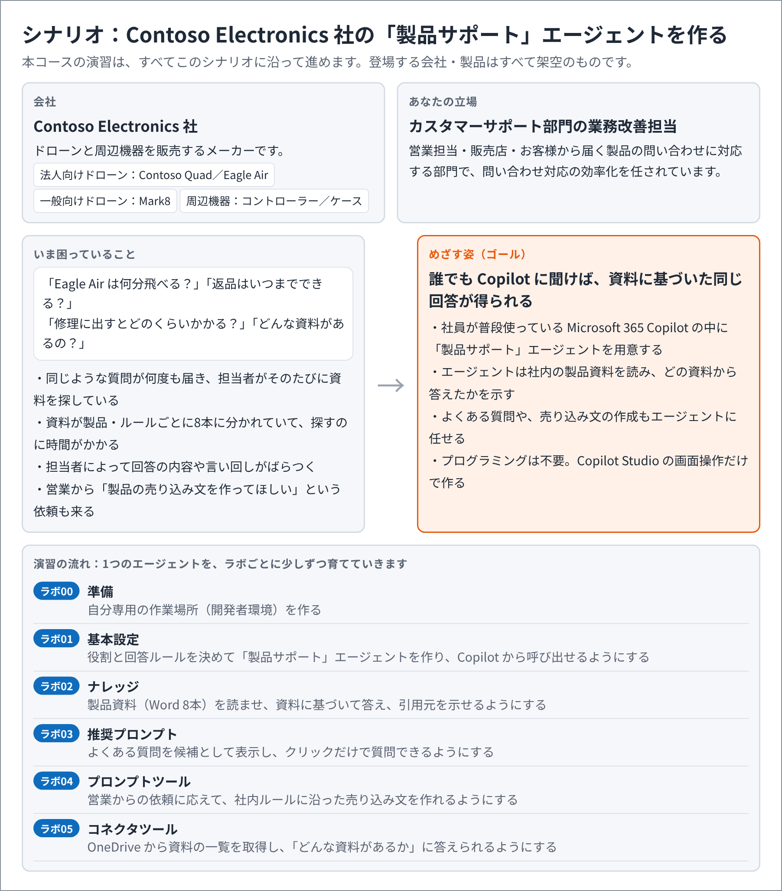

このラボでは、エージェントを作る前の準備として、Copilot Studio で使う自分専用の作業場所（開発者環境）を作成します。開発者環境は受講者ごとに1つずつ作成し、他の受講者の作業とは分かれています。

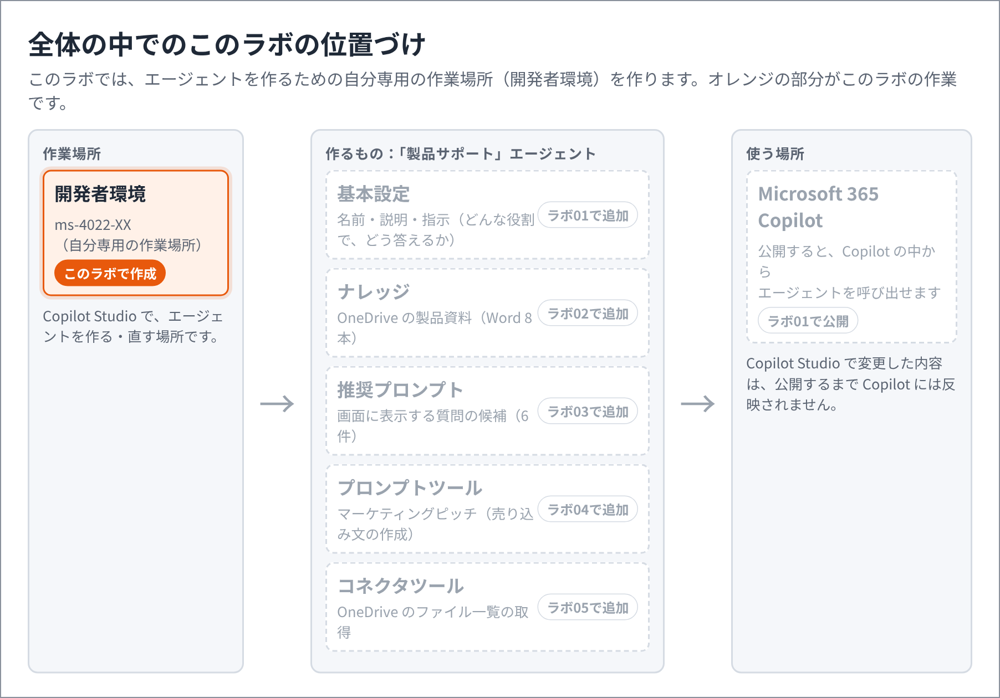

このラボでは以下のタスクを実施します。

　**タスク１：Power Platform 管理センターにサインインする**

　**タスク２：開発者環境を作成する**

　**タスク３：Copilot Studio で環境を切り替える**

　**タスク４：クラシック エクスペリエンスを開く**


## 予想時間: 15分


## タスク1 - Power Platform 管理センターにサインインする

> **このタスクの目的：** 開発者環境を作るための管理画面（Power Platform 管理センター）に、配布されたアカウントでサインインします。

1. Microsoft Edge を InPrivate ウィンドウで開き（キーボードの **Ctrl** ＋ **Shift** ＋ **N**）、アドレスバーに以下の URL を入力して **Enter** キーを押します。

   ```
   https://admin.powerplatform.microsoft.com/manage/environments
   ```

   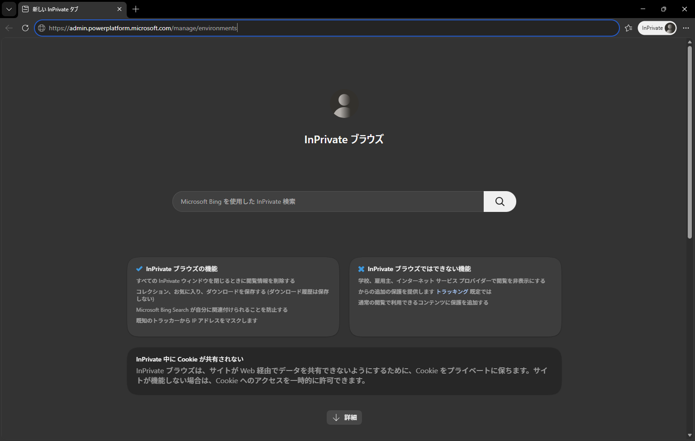

   

2. サインイン画面が表示されたら、講師から事前に配布したアカウントを入力し、「**次へ**」をクリックします。

   > 注：XXはご自身のアカウント番号を入力してください。

   | 項目       | 値                                                         |
   | ---------- | ---------------------------------------------------------- |
   | アカウント | 講師から事前に配布したアカウント（`ms-4022-XX@ctctedu.onmicrosoft.com`） |

   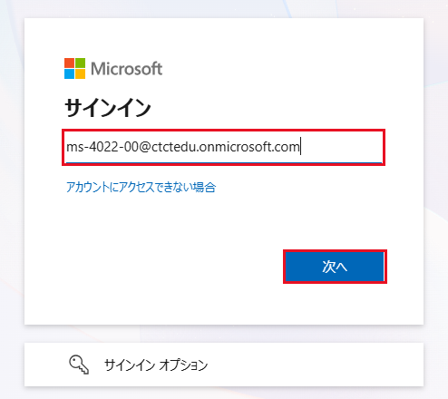

   

3. パスワードを入力し、「**サインイン**」をクリックします。

   | 項目       | 値                 |
   | ---------- | ------------------ |
   | パスワード | `Pa55w.rd1234` |

   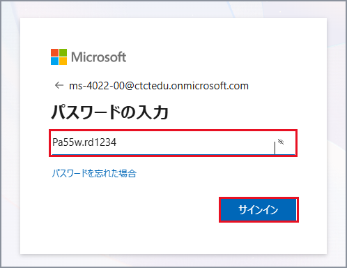

   

4. 「**サインインの状態を維持しますか?**」と表示されたら、「**はい**」をクリックします。

   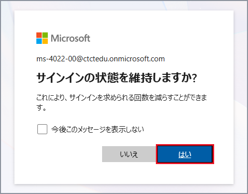

   

5. 「**環境、リソース、分析**」などの案内（右上に「1 / 5」と表示される吹き出し）が表示された場合は、吹き出しの右上の「**×**」をクリックして閉じます。

   


## タスク2 - 開発者環境を作成する

> **このタスクの目的：** 自分専用の作業場所（開発者環境）を作成します。以降のラボで作るエージェントは、すべてこの環境に保存されます。

1. 「**環境**」の画面が表示されたら、画面上部の「**＋ 新規**」をクリックします。

   > 注：一覧に「環境なし」、「環境の取得中にエラーが発生しました。」、または他の環境が表示される場合がありますが、問題ありません。そのまま操作を続けてください。

   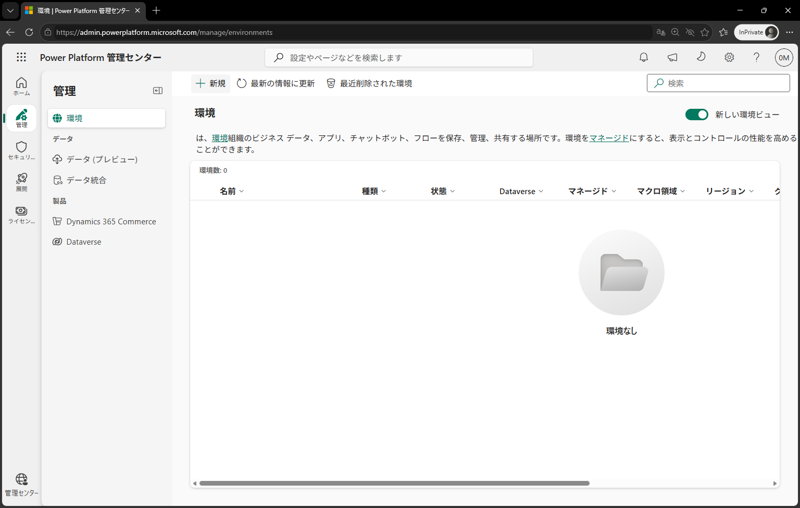

   

2. 画面右側に「**新しい環境**」が表示されたら、上から順に以下の項目を設定し、画面下部の「**次へ**」をクリックします。

   > 注：表に無い項目は[デフォルトの値]のままとします。「既定の設定を変更する」は開く必要はありません。

   | 項目             | 値                                              |
   | ---------------- | ----------------------------------------------- |
   | 種類             | 一覧から **開発者** を選択                      |
   | マクロ地域の地域 | 一覧から **アジア太平洋** を選択                |
   | 名前             | 自動入力された文字を消して `ms-4022-XX` を入力 |

   > 注：「マクロ地域の地域」が空欄のままだと「**次へ**」はクリックできません。必ず「**アジア太平洋**」を選択してください。

   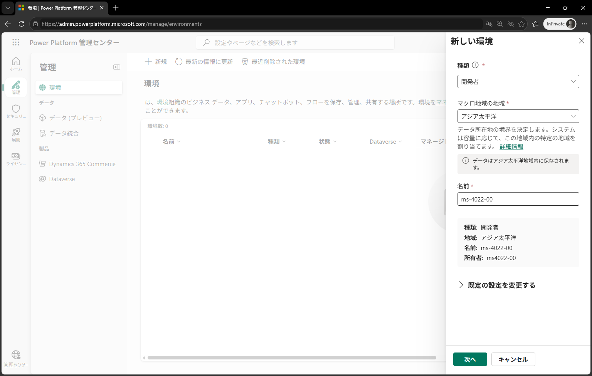

   

3. 「**Dataverse を追加**」が表示されたら、以下の項目を確認し、画面下部の「**保存**」をクリックします。

   | 項目                             | 値                          |
   | -------------------------------- | --------------------------- |
   | 言語                             | **日本語 (日本)**           |
   | 通貨                             | **JPY (¥)**                 |
   | サンプル アプリおよびデータの展開 | **いいえ**（既定のまま）    |

   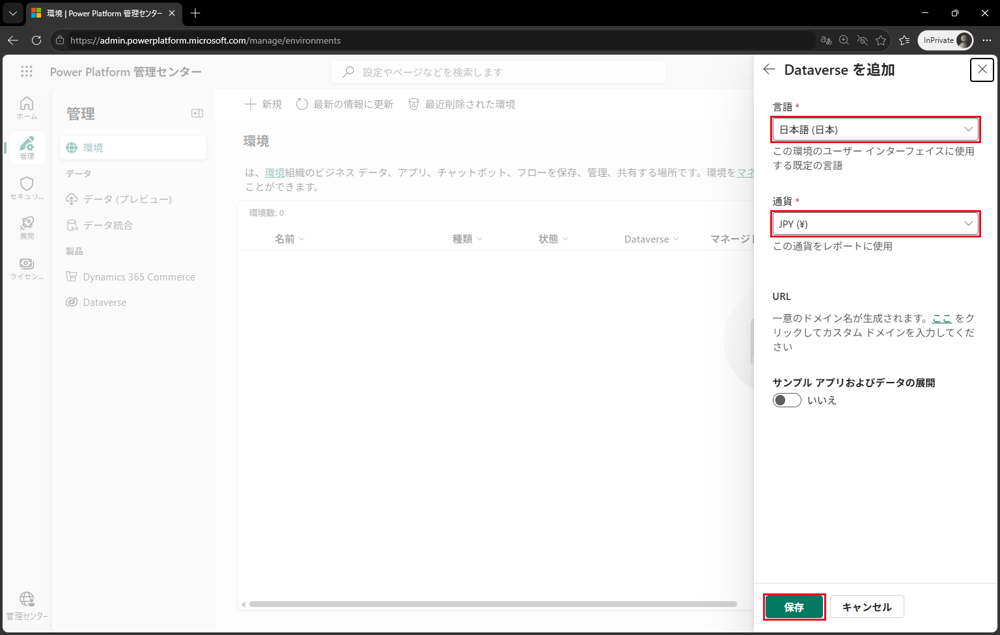

   

4. 一覧に作成した環境が表示され、「**状態**」が「**準備中**」となります。そのまましばらく待ちます。

   > 注：完了までに3〜5分ほどかかります。状態が「準備中」のまま変わらない場合は、キーボードの **F5** キーを押して画面を更新してください。

   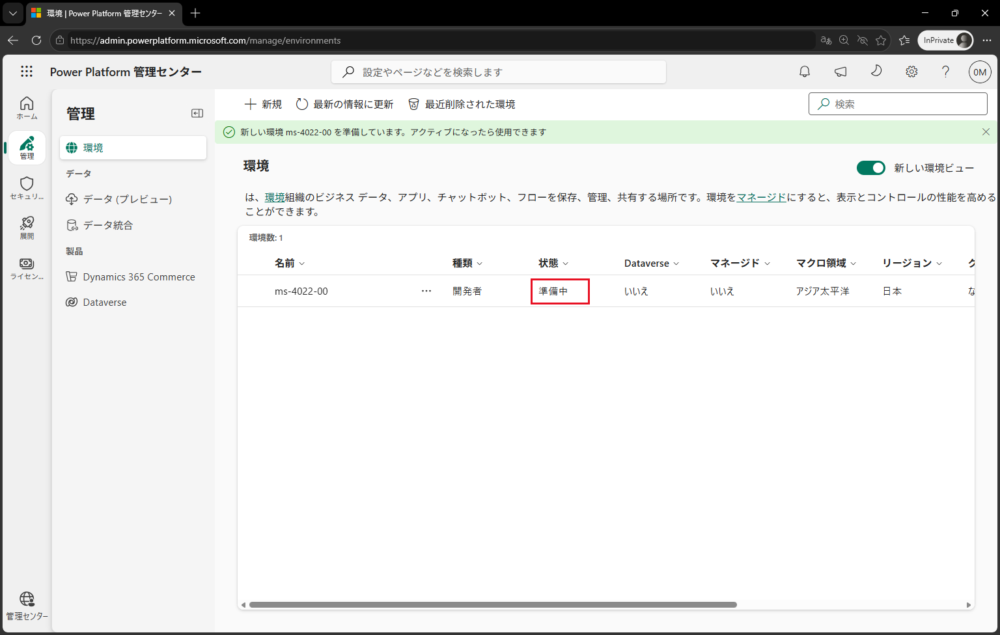

   

5. 「**状態**」が「**準備完了**」、「**Dataverse**」が「**はい**」になったことを確認します。

   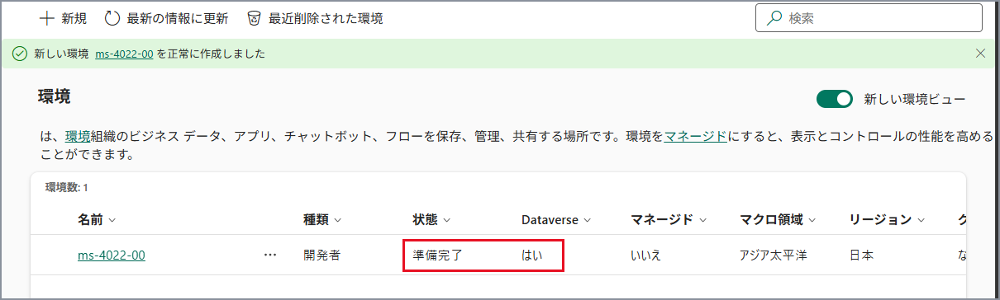

   


## タスク3 - Copilot Studio で環境を切り替える

> **このタスクの目的：** Copilot Studio の作業場所を、タスク2で作成した自分の環境に切り替えます。

1. 新しいタブを開き（キーボードの **Ctrl** ＋ **T**）、アドレスバーに以下の URL を入力して **Enter** キーを押します。

   ```
   https://copilotstudio.microsoft.com/
   ```

   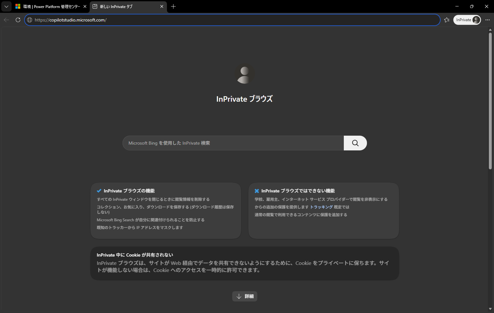

   

2. Copilot Studio のホーム画面が表示されます。画面左下に「**ここで環境を見つけてください**」と表示された場合は、「**了解しました**」をクリックします。

   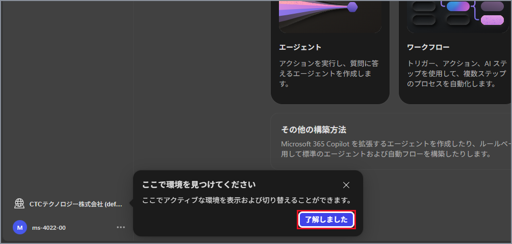

   

3. 画面左下の環境名（「**CTCテクノロジー株式会社 (default)**」）をクリックし、「**環境の切り替え**」の一覧から「**ms-4022-XX**」（種類：開発者）をクリックします。

   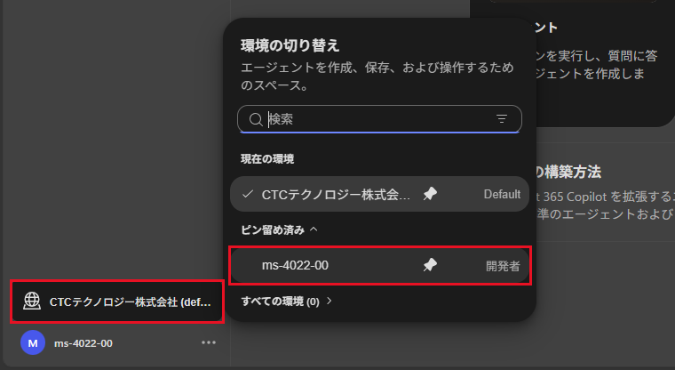

   

4. 「**現在の環境**」と画面左下の表示が「**ms-4022-XX**」に変わったことを確認します。確認できたら、一覧の外側をクリックして閉じます。

   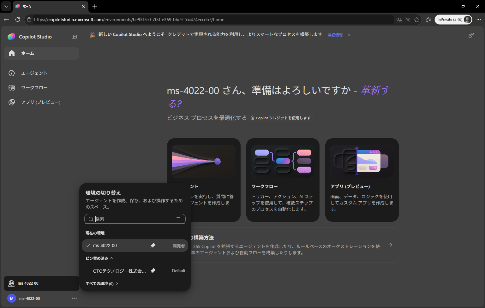

   


## タスク4 - クラシック エクスペリエンスを開く

> **このタスクの目的：** 本コースの演習で使う「クラシック エクスペリエンス」の画面に切り替えます。

> 注：本コースの演習は、Copilot Studio の「**クラシック エクスペリエンス**」の画面で実施します。

1. 画面左下のアカウント名の右にある「**…**」をクリックし、「**クラシック エクスペリエンスを開く**」をクリックします。

   > 注：クラシック エクスペリエンスは新しいタブで開きます。
   >
   > 注：「Microsoft にフィードバックを送信」の画面が表示された場合は、「**フィードバックをスキップ**」をクリックしてください。
   >
   > 注：「**以前のエクスペリエンスを開きますか？**」と表示された場合は、「**新しいタブで開く**」をクリックしてください。

   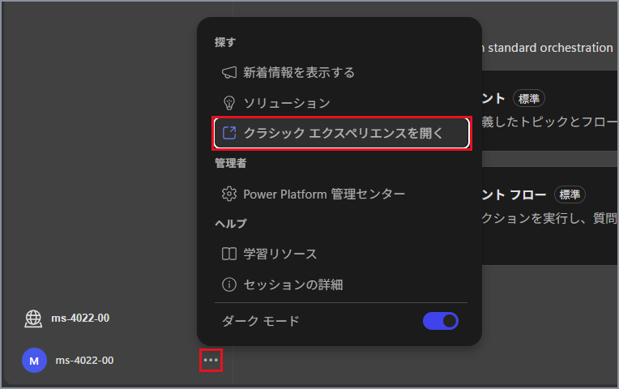

   

2. 「**Microsoft Copilot Studio にようこそ**」と表示された場合は、「**開始する**」をクリックします。

   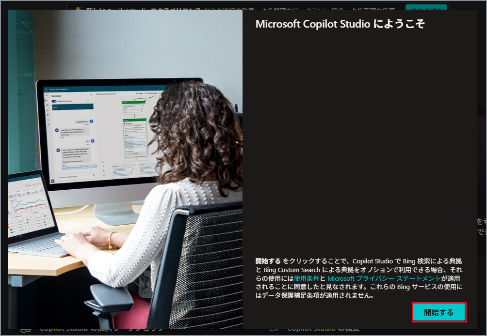

   

3. 「**Copilot Studio へようこそ!**」と表示された場合は、「**スキップ**」をクリックします。

   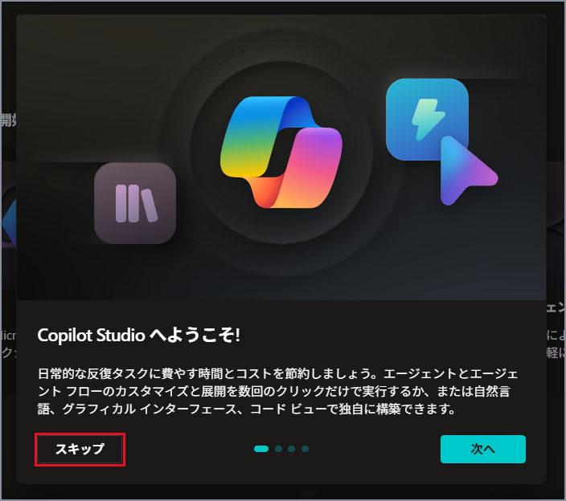

   

4. 画面右上の「**環境**」が「**ms-4022-XX**」になっていることを確認します。

   > 注：以降の演習は、このクラシック エクスペリエンスのタブで実施します。

   

以上で本ラボは完了です。
