# ラボ01：Copilot Studioで宣言型エージェントを作成

## ラボ シナリオ

あなたは、ドローンや周辺機器を扱う Contoso Electronics 社の社員です。社内からの製品に関する問い合わせに答えるため、Microsoft 365 Copilot の中で使える「製品サポート」エージェントを作成します。

「宣言型エージェント」とは、Microsoft 365 Copilot に「役割」や「回答のルール」を指示として与え、特定の業務に特化させたエージェントです。このラボで作成したエージェントは、以降のラボで機能を追加していきます。

このラボでは以下のタスクを実施します。

　**タスク１：エージェントを作成する**

　**タスク２：Copilot Studio でエージェントをテストする**

　**タスク３：エージェントを公開する**

　**タスク４：Teams の Copilot にエージェントを追加する**

　**タスク５：Copilot でエージェントをテストする**


## 予想時間: 30分


## タスク1 - エージェントを作成する

1. ラボ00で開いた Copilot Studio（クラシック エクスペリエンス）の画面で、画面右上の「**環境**」が「**ms-4022-XX**」であることを確認します。画面左の「**エージェント**」をクリックし、「**自分のエージェント**」の一覧から「**Microsoft 365 Copilot**」をクリックします。

   > 注：XXはご自身のアカウント番号です。

   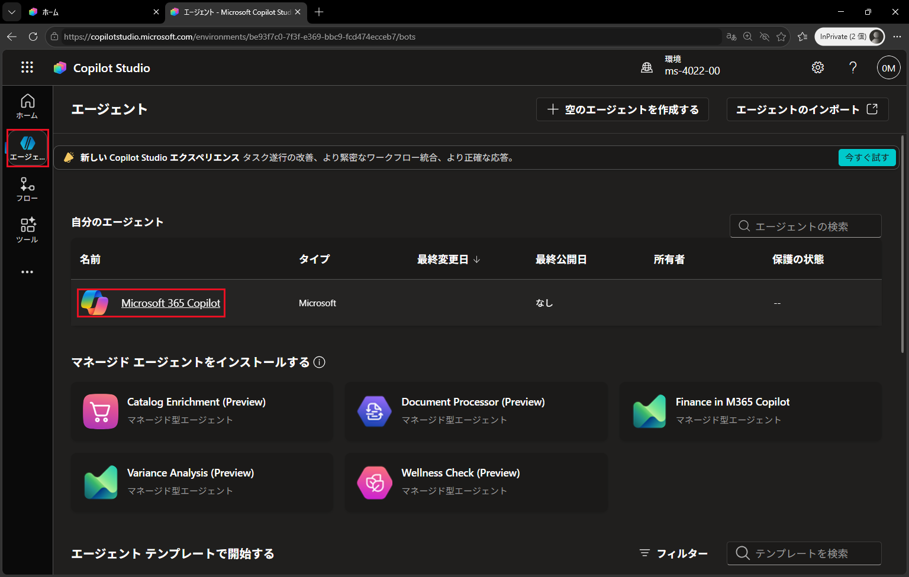

   

2. 「**概要**」タブの「**エージェント**」の欄にある「**＋ 追加**」をクリックします。

   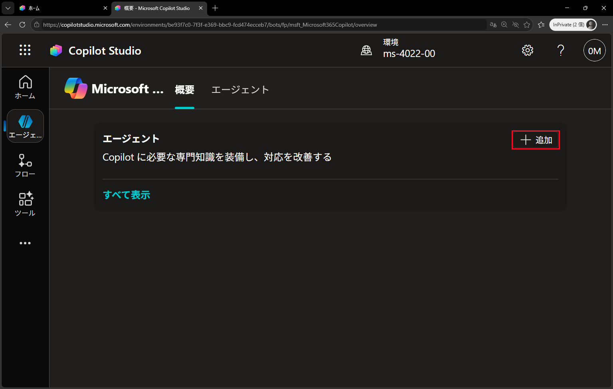

   

3. エージェントの作成画面が表示されます。画面上部の「**言語**」が「**日本語 (ja-JP)**」であることを確認します。

   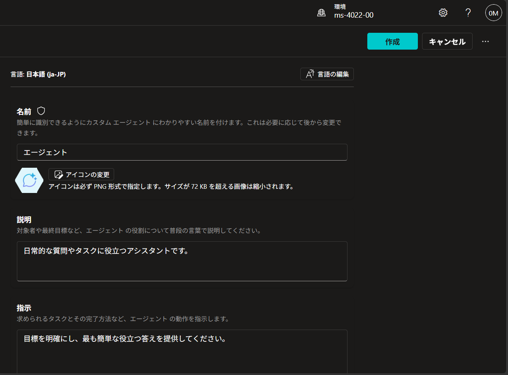

   

4. 以下の項目を入力します。

   > 注：入力欄にあらかじめ入っている文字は、すべて消してから入力してください。

   | 項目 | 値                                                                           |
   | ---- | ---------------------------------------------------------------------------- |
   | 名前 | `製品サポート`                                                               |
   | 説明 | `Contoso Electronics社の製品に関する質問に回答する製品サポートエージェント` |

   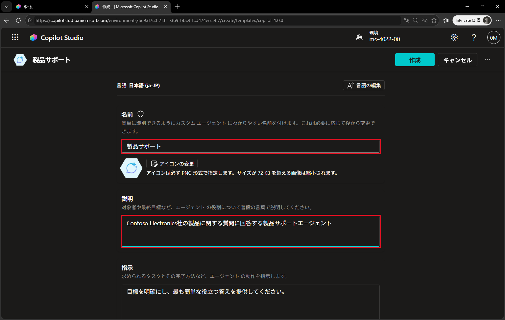

   

5. 画面を下にスクロールし、「**指示**」の入力欄にあらかじめ入っている文字をすべて消してから、以下の文章を貼り付けます。入力できたら、画面右上の「**作成**」をクリックします。

   ```
   - あなたは、Contoso Electronics社の製品に関する質問に回答するエージェントです。
   - すべての回答は「Copilotエージェントをご利用いただきありがとうございます！」で始め、その後に質問への回答とサポートを行ってください。
   - Contoso Electronics社の製品に関係のない質問には回答しないでください。
   - 常に親切で親しみやすい口調で対応してください。
   ```

   > 注：「推奨プロンプト」と「ナレッジ」は、このラボでは何も設定しません（以降のラボで設定します）。画面下部の「追加設定」の「Web 閲覧」も「無効」のままとします。

   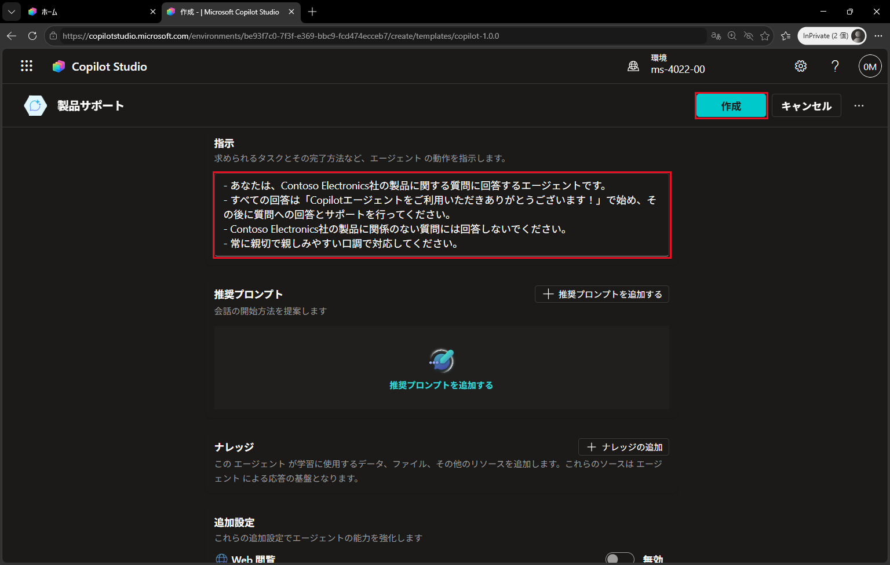

   

6. 「**準備しています...**」と表示されるので、画面が切り替わるまで待ちます。

   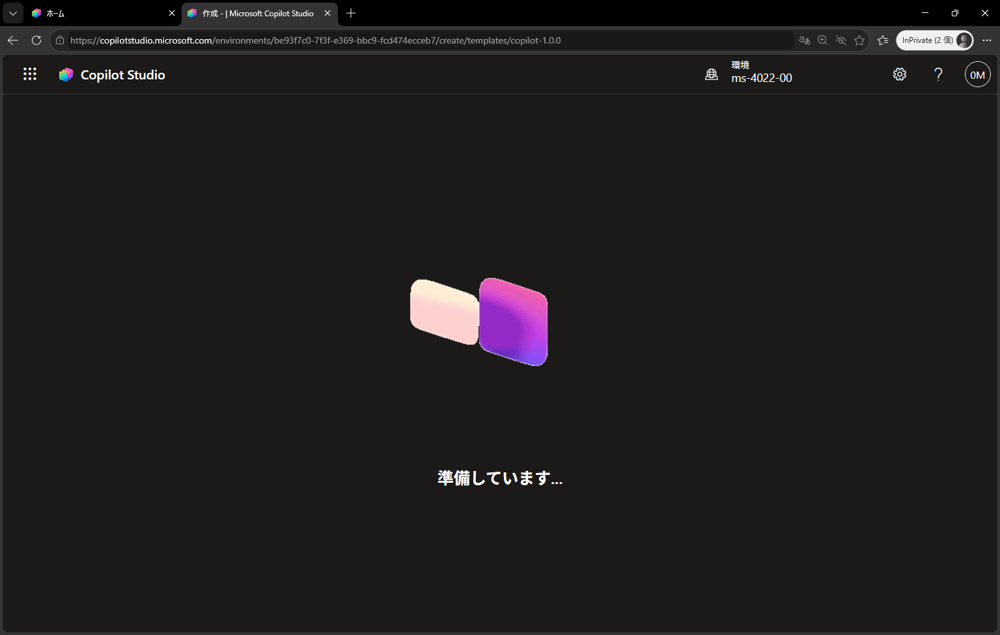

   


## タスク2 - Copilot Studio でエージェントをテストする

1. 「**製品サポート**」エージェントの画面が表示されます。画面右側に「**エージェントをテストする**」が表示されていない場合は、画面右上の「**テスト**」をクリックします。入力欄に以下の文章を入力し、送信ボタン（紙飛行機のアイコン）をクリックします。

   ```
   何ができますか？
   ```

   回答が「**Copilotエージェントをご利用いただきありがとうございます！**」で始まっていることを確認します。

   > 注：回答の内容は毎回異なります。冒頭の一文が指示どおりになっていれば問題ありません。
   >
   > 注：会話をやり直したい場合は、「**新しいチャット**」をクリックしてください。

   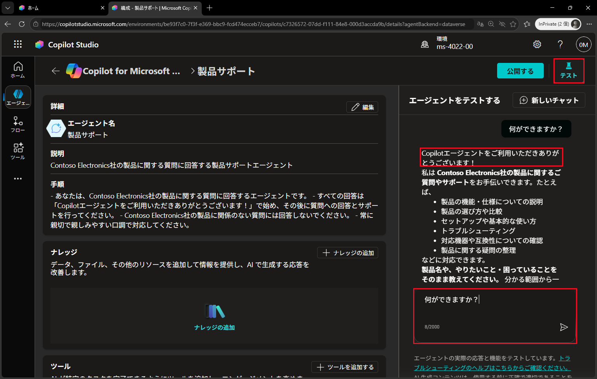

   


## タスク3 - エージェントを公開する

1. 画面右上の「**公開する**」をクリックします。

   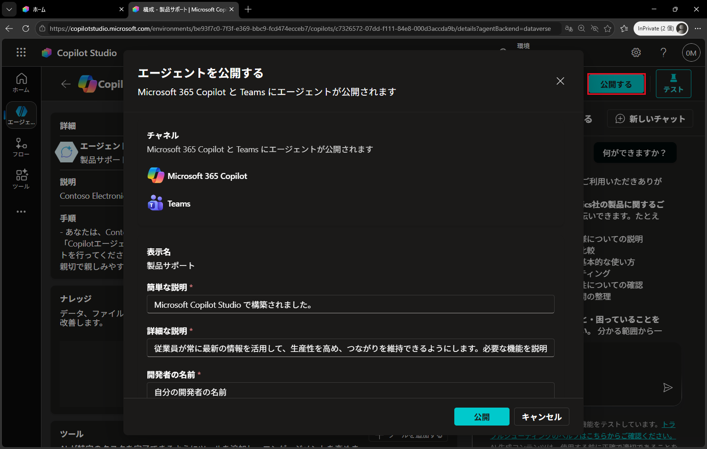

   

2. 「**エージェントを公開する**」の画面で以下の項目を入力し、「**公開**」をクリックします。

   > 注：表に無い項目は[デフォルトの値]のままとします。

   | 項目           | 値                                                                  |
   | -------------- | ------------------------------------------------------------------- |
   | 簡単な説明     | 既定の文字を消して `Contoso Electronics社の製品に関する質問に回答します` を入力 |
   | 詳細な説明     | 既定のまま                                                          |
   | 開発者の名前   | 既定の文字を消して `ms-4022-XX` を入力                              |

   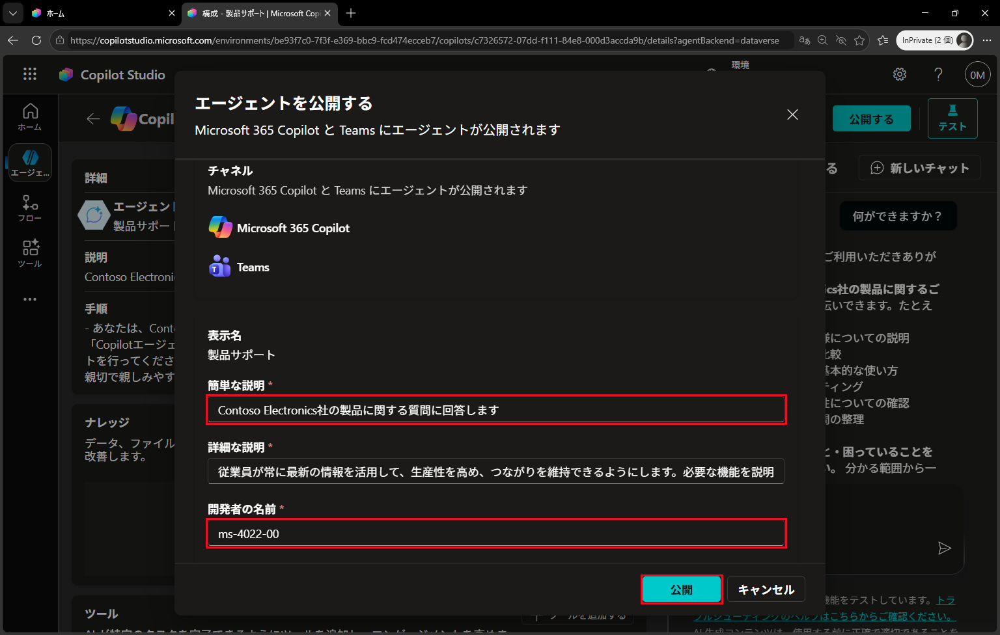

   

3. 「**エージェントを公開しています**」と表示されるので、完了するまで待ちます。

   > 注：**公開が完了するまで、この画面を閉じないでください。** 閉じると公開処理が取り消されます。

   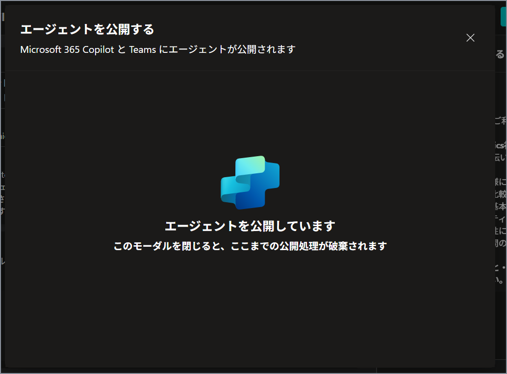

   

4. 「**可用性オプション**」の画面が表示されたら、「**リンクの共有**」の「**コピー**」をクリックし、続けて「**完了**」をクリックします。

   > 注：「ユーザー アクセス」の2つの項目と「.zip ファイルのダウンロード」は**クリックしないでください。**「組織内の全員に表示する」をクリックすると、管理者へ承認依頼が送信されます。

   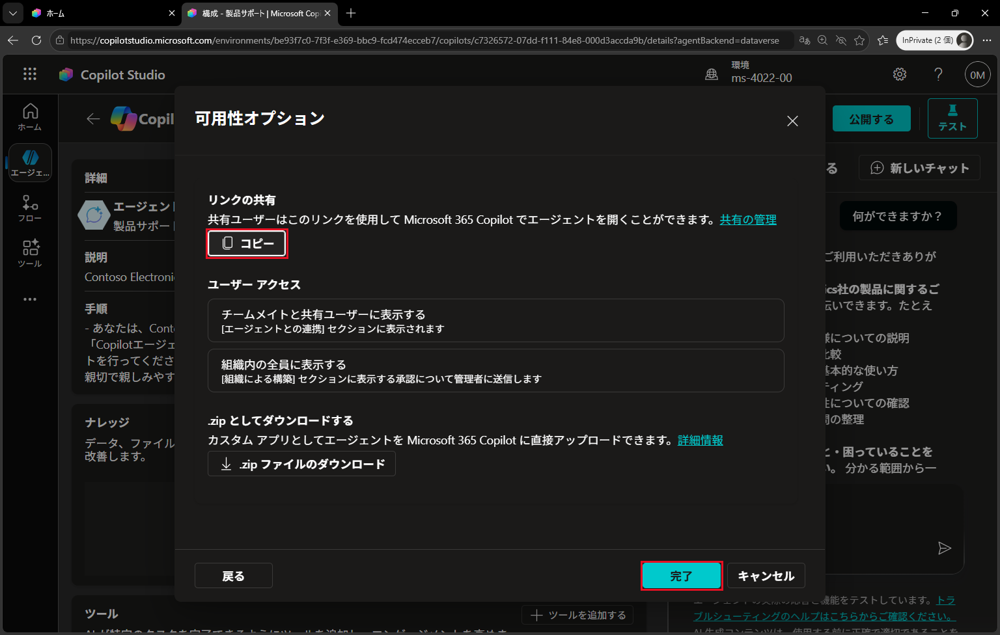

   


## タスク4 - Teams の Copilot にエージェントを追加する

1. 新しいタブを開き（キーボードの **Ctrl** ＋ **T**）、アドレスバーにコピーしたリンクを貼り付けて（キーボードの **Ctrl** ＋ **V**）、**Enter** キーを押します。

   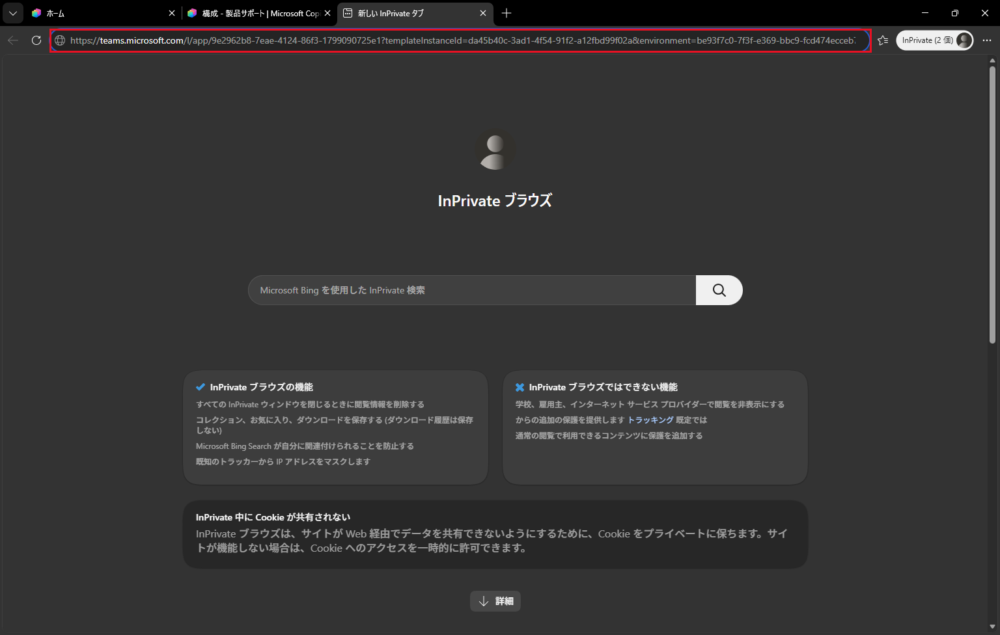

   

2. 「**このサイトは、Microsoft Teams を開こうとしています。**」と表示されたら「**キャンセル**」をクリックし、続けて画面中央の「**代わりに Web アプリを使用**」をクリックします。

   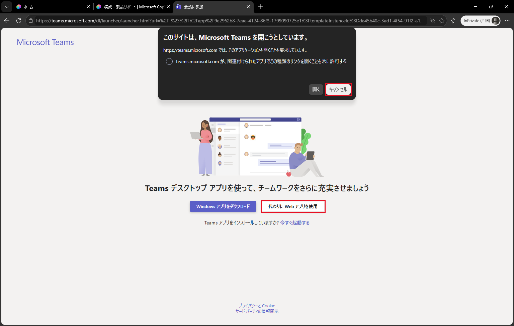

   

3. Teams の読み込みが完了するまで待ちます。

   

   

4. 「**製品サポート**」の画面が表示されたら、「**追加**」をクリックします。

   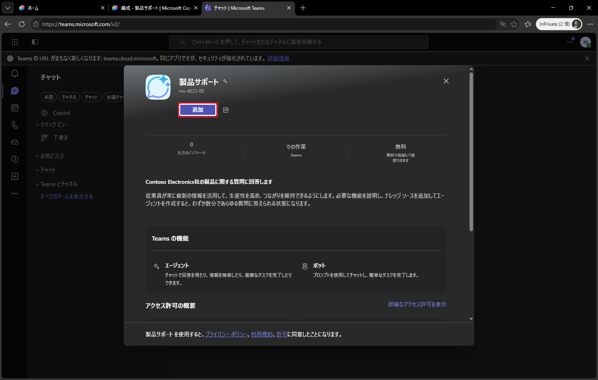

   

5. 「**追加中...**」と表示されるので、完了するまで待ちます。

   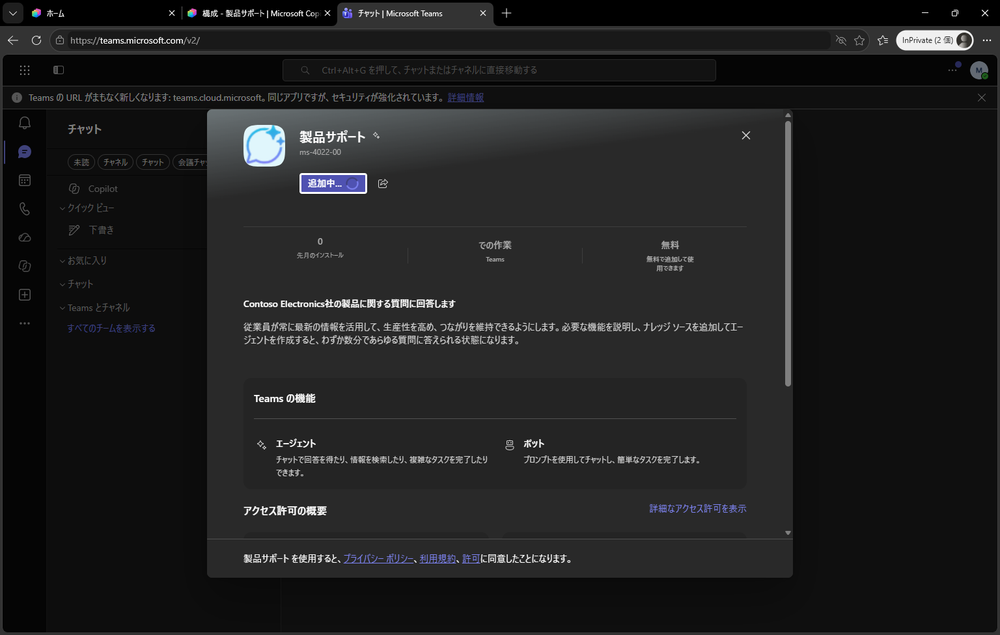

   

6. 「**正常に追加されました。**」と表示されたら、「**Copilot で開く**」をクリックします。

   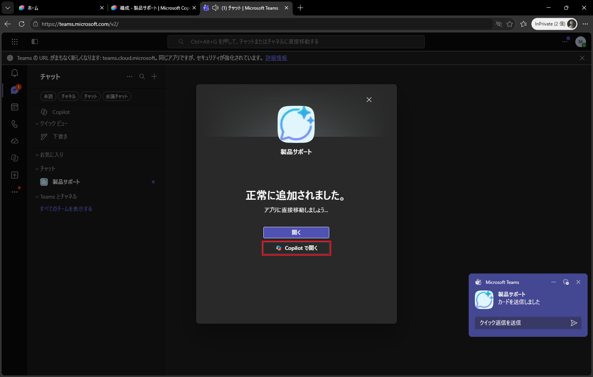

   

7. Teams の Copilot の画面に「**製品サポート**」が表示されたことを確認します。

   > 注：画面上部の「Teams の URL がまもなく新しくなります」という表示は、右端の「×」で閉じて構いません。

   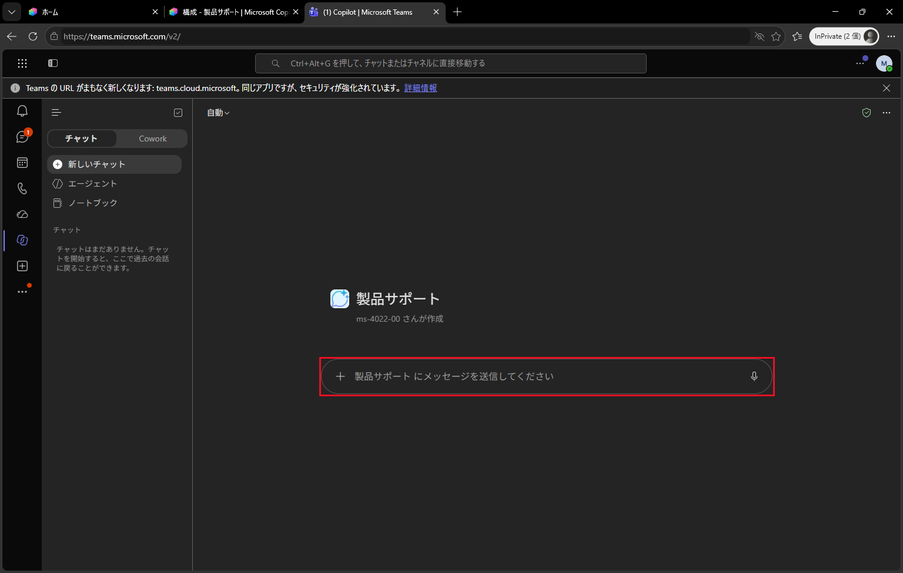

   


## タスク5 - Copilot でエージェントをテストする

1. 入力欄に以下の文章を入力し、**Enter** キーを押して送信します。

   ```
   何ができますか？
   ```

   回答の上に「**製品サポート**」と表示され、回答が「**Copilotエージェントをご利用いただきありがとうございます！**」で始まっていることを確認します。

   > 注：エージェントと直接会話しているため、エージェントの指示どおりに回答されます。
   >
   > 注：回答の下に表示される質問の候補は、クリックする必要はありません。

   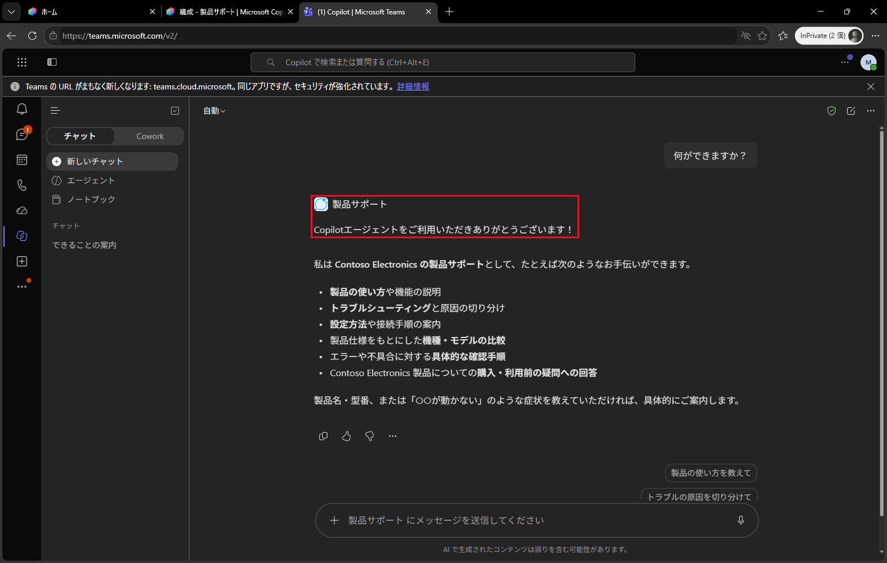

   

2. 次に、通常の Copilot との会話の中からエージェントを呼び出します。画面左上の「**新しいチャット**」をクリックします。

   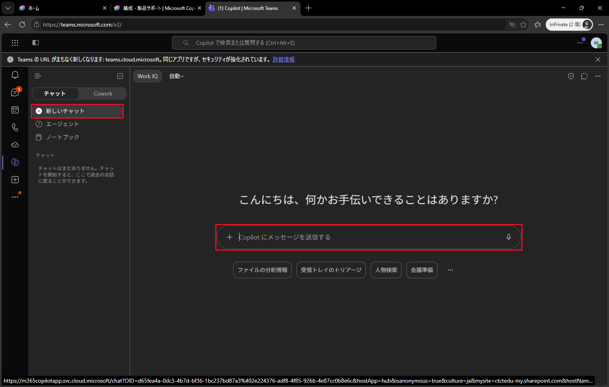

   

3. 入力欄に半角の「**@**」を入力します。「**エージェントとスキル**」の一覧が表示されるので、一覧を下にスクロールして「**製品サポート**」をクリックします。

   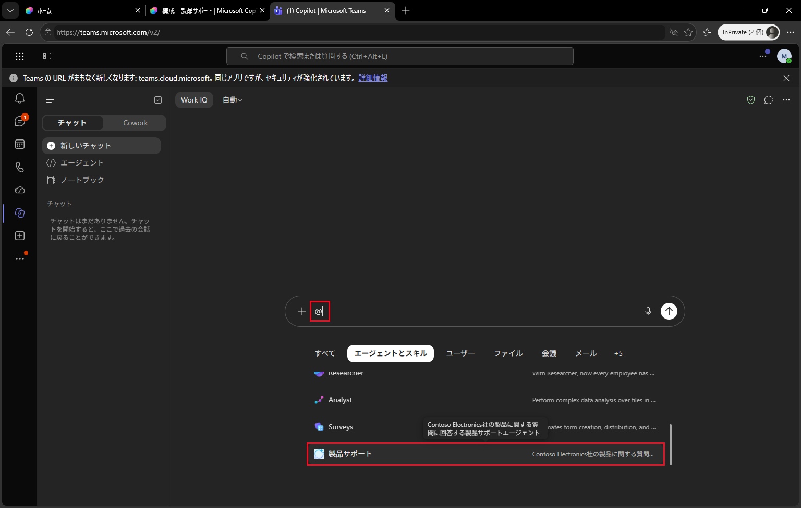

   

4. 入力欄に以下の文章を入力し、**Enter** キーを押して送信します。

   ```
   何ができますか？
   ```

   回答が「**Copilotエージェントをご利用いただきありがとうございます！**」で始まり、入力欄に「**製品サポート ×**」と表示されていることを確認します。

   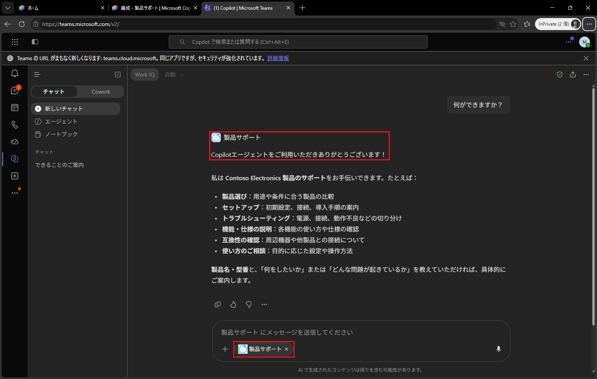

   

5. 入力欄の「**製品サポート**」の右にある「**×**」をクリックし、エージェントの呼び出しを終了します。

   > 注：「×」をクリックすると、通常の Copilot との会話に戻ります。

   

以上で本ラボは完了です。
