# ラボ03：宣言型エージェントに推奨プロンプトを追加

## ラボ シナリオ

「推奨プロンプト」とは、エージェントを開いたときに表示される質問の候補です。利用者は候補をクリックするだけで質問できるため、何を聞けばよいか迷わずにエージェントを使い始められます。

このラボでは、「製品サポート」エージェントに推奨プロンプトを6件追加し、ラボ02・ラボ03で変更した内容を公開して、Microsoft 365 Copilot で確認します。

このラボでは以下のタスクを実施します。

　**タスク１：推奨プロンプトを追加する**

　**タスク２：Copilot Studio でテストする**

　**タスク３：エージェントを再公開する**

　**タスク４：Microsoft 365 Copilot でテストする**


## 予想時間: 20分


## タスク1 - 推奨プロンプトを追加する

1. Copilot Studio の「**製品サポート**」の画面を下にスクロールし、「**推奨プロンプト**」の欄にある「**＋ 推奨プロンプトを追加する**」をクリックします。

   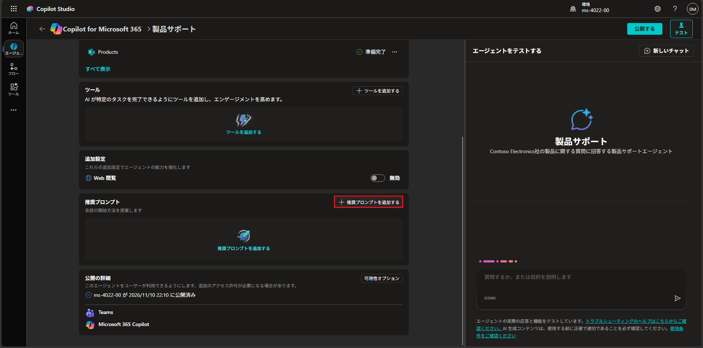

   

2. 以下の6件を「**タイトル**」と「**プロンプト**」に入力し、「**推奨プロンプト**」の欄の右上にある「**保存**」をクリックします。

   | タイトル         | プロンプト                                                   |
   | ---------------- | ------------------------------------------------------------ |
   | `Eagle Air`      | `Eagle Airについて教えてください`                            |
   | `返品ポリシー`   | `返品ポリシーを教えてください`                               |
   | `製品情報`       | `特定の製品について情報を教えてもらえますか？`               |
   | `製品のトラブル` | `製品にトラブルがあります。解決方法を教えてもらえますか？`   |
   | `修理について`   | `製品を修理に出す方法を教えてください`                       |
   | `サポート窓口`   | `サポートに問い合わせるにはどうすればよいですか？`           |

   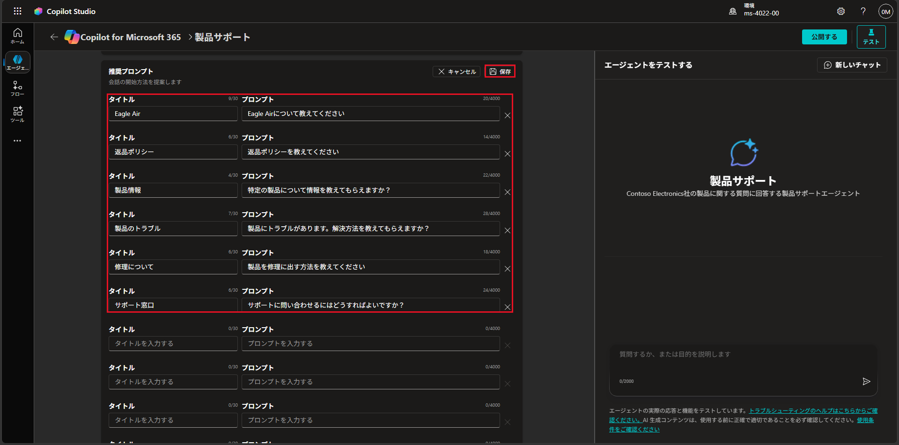

   

3. 「**推奨プロンプト**」の欄と、画面右側の「**エージェントをテストする**」に6件が表示されたことを確認します。

   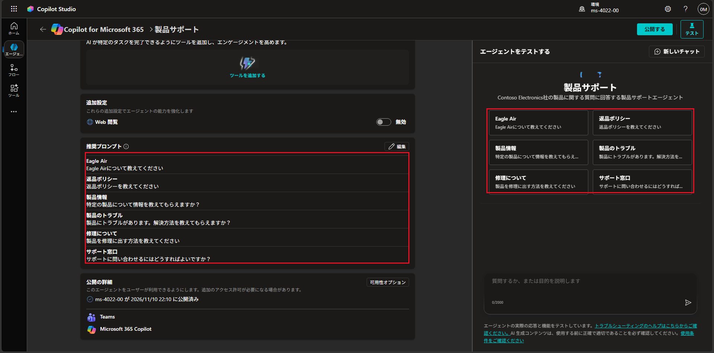

   


## タスク2 - Copilot Studio でテストする

1. 「**エージェントをテストする**」に表示された推奨プロンプトをクリックすると、入力欄にプロンプトの文章が入ります。

   > 注：画面は「Eagle Air」をクリックした例です。

   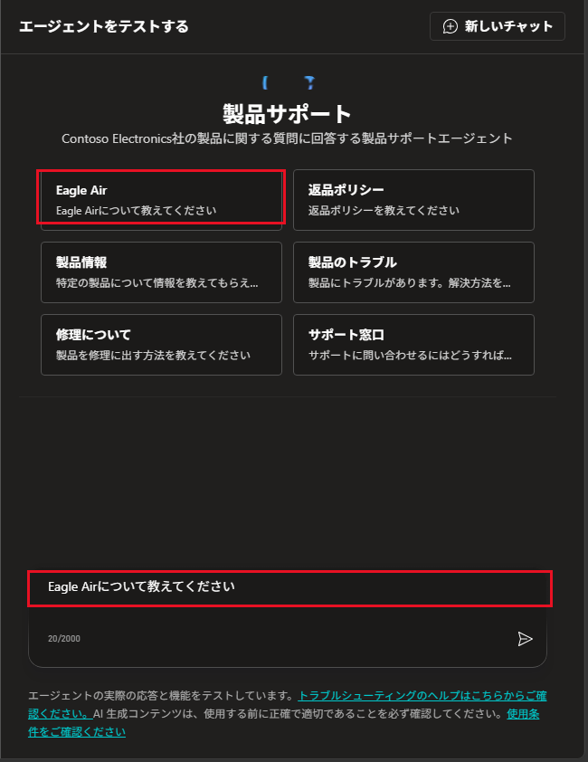

   

2. 「**サポート窓口**」をクリックし、送信ボタンをクリックします。回答の下に、引用元（**Repairs**）が表示されていることを確認します。

   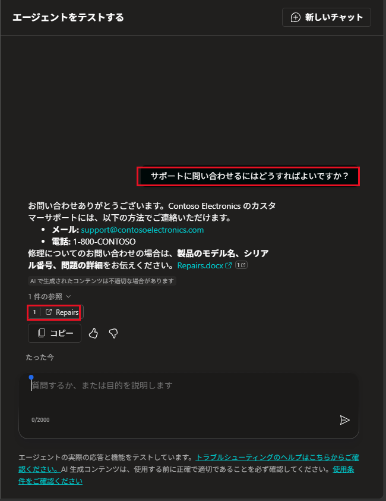

   


## タスク3 - エージェントを再公開する

> 注：ラボ02・ラボ03で変更した内容は、公開するまで Microsoft 365 Copilot には反映されません。

1. 画面右上の「**公開する**」をクリックします。

   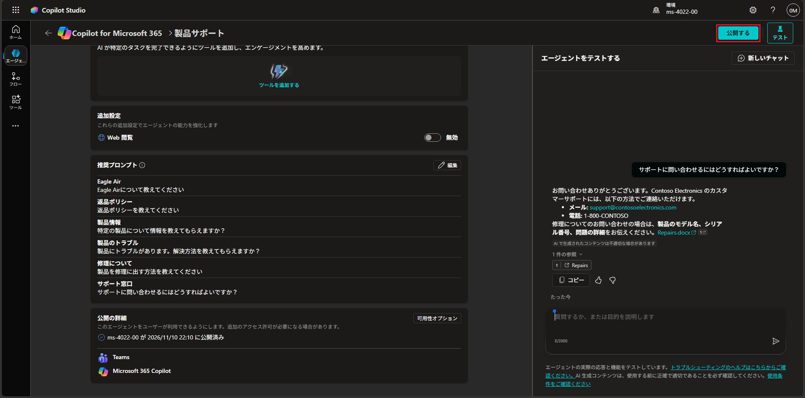

   

2. 「**エージェントを公開する**」の画面で、ラボ01で入力した内容が残っていることを確認し、「**公開**」をクリックします。

   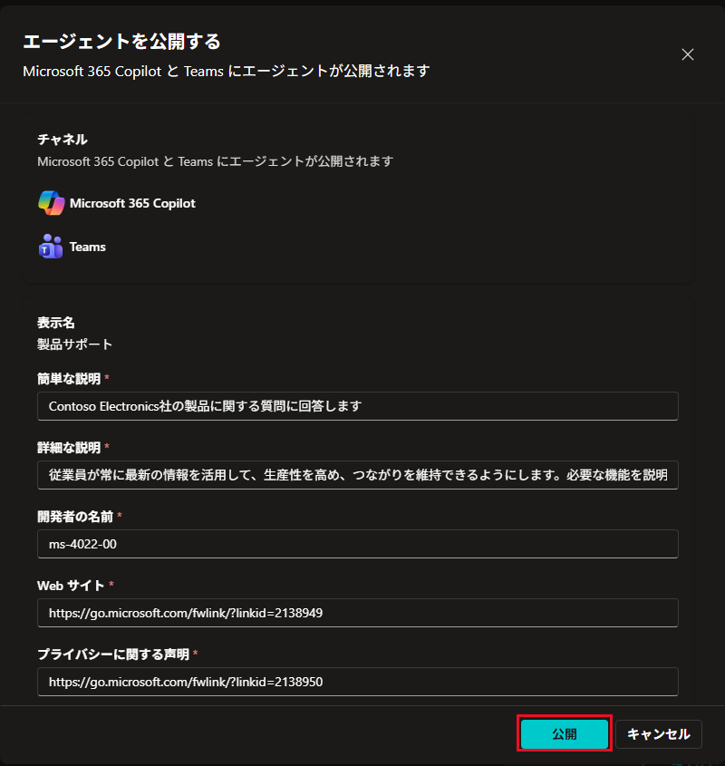

   

3. 「**エージェントを公開しています**」と表示されるので、完了するまで待ちます。

   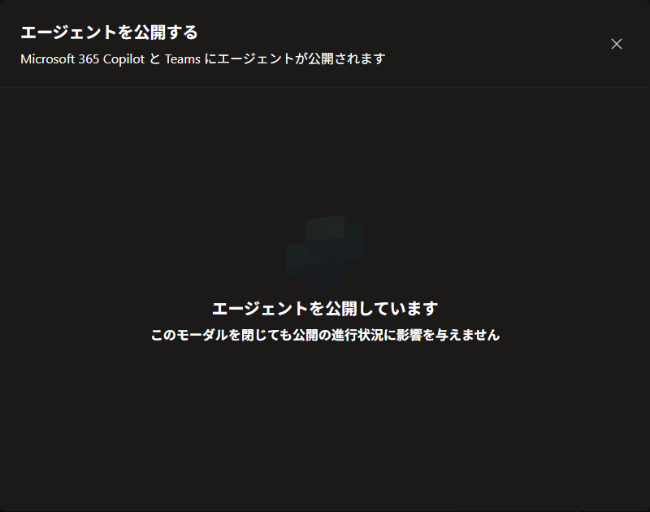

   

4. 「**可用性オプション**」の画面が表示されたら、「**完了**」をクリックします。

   > 注：エージェントはラボ01で Copilot に追加済みのため、リンクのコピーは不要です。「ユーザー アクセス」の2つの項目は**クリックしないでください。**

   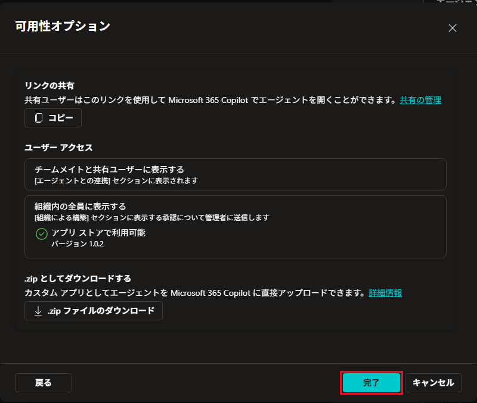

   


## タスク4 - Microsoft 365 Copilot でテストする

> 注：公開した内容が Copilot に反映されるまで、**5〜10分ほど**かかります。

1. 新しいタブを開き（キーボードの **Ctrl** ＋ **T**）、アドレスバーに以下の URL を入力して **Enter** キーを押します。「**All your work in one place**」と表示された場合は、「**表示する**」をクリックします。

   ```
   https://copilot.cloud.microsoft/
   ```

   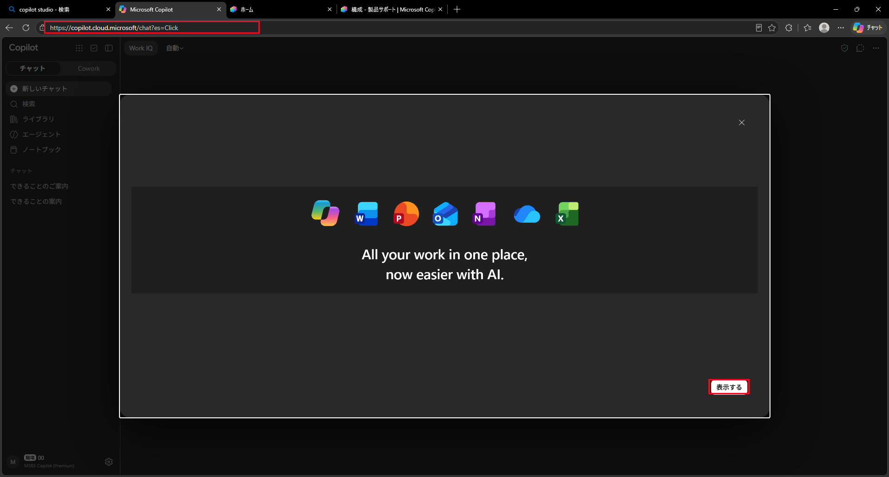

   

2. 画面左の「**新しいチャット**」をクリックします。続けて「**エージェント**」にマウスポインターを合わせ、表示された一覧から「**製品サポート**」をクリックします。

   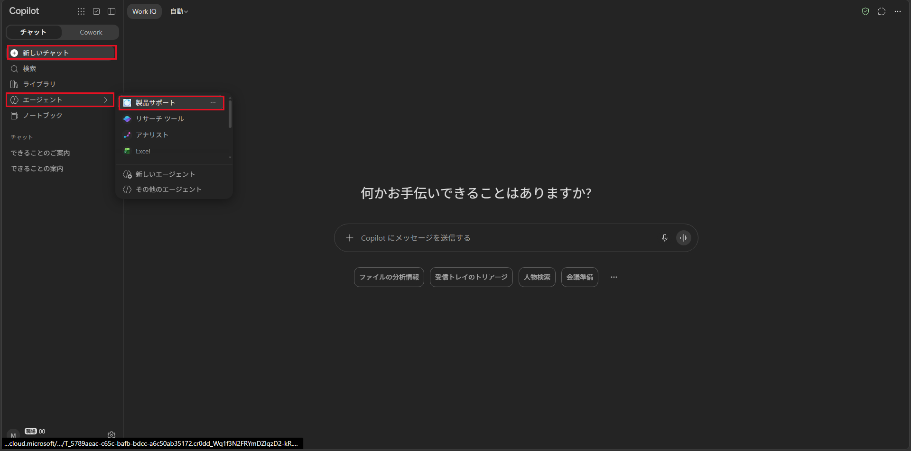

   

3. 「**製品サポート**」の画面に、推奨プロンプトが表示されていることを確認します。

   > 注：3件のみ表示されている場合は、右下の「**表示を増やす**」をクリックすると6件すべてが表示されます。
   >
   > 注：推奨プロンプトが表示されない場合は、数分待ってから手順2をやり直してください。

   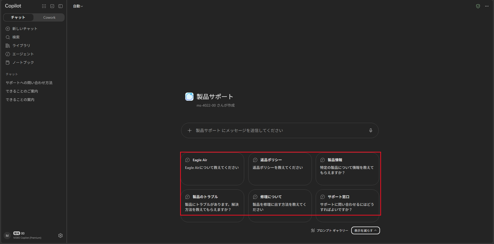

   

4. 「**サポート窓口**」をクリックし、送信します。回答が感謝の言葉で始まり、引用元（**Repairs**）が表示されていることを確認します。

   > 注：回答が「**Copilotエージェントをご利用いただきありがとうございます！**」で始まる場合は、ラボ01の古い設定のままです。数分待ってから「**新しいチャット**」で製品サポートを開き直し、もう一度お試しください。

   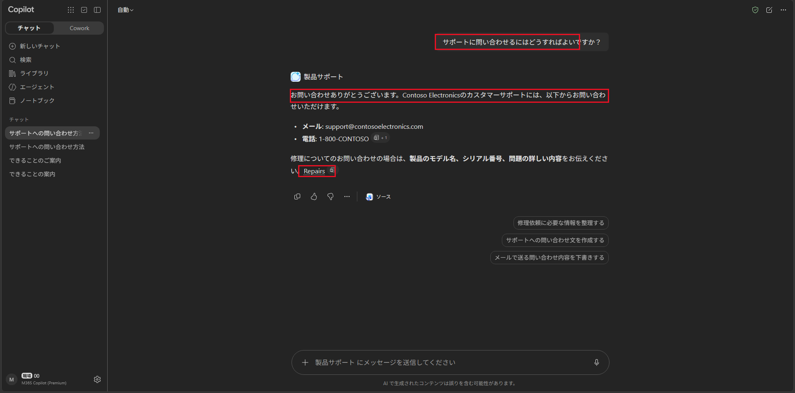

   

以上で本ラボは完了です。
