# ラボ04：プロンプトツールを作成してエージェントに追加

## ラボ シナリオ

カスタマーサポート部門には、営業から「製品の売り込み文を作ってほしい」という依頼も届きます。依頼のたびに担当者が考えると、文章の構成やトーンがばらばらになってしまいます。

「プロンプトツール」とは、決まった指示（プロンプト）をあらかじめ登録しておき、エージェントが必要なときに呼び出せるようにしたものです。このラボでは、製品のアイデア（下書き）から、Contoso 社のガイドラインに沿ったマーケティングピッチ（売り込み文）を作る「マーケティングピッチ」ツールを作成し、エージェントに追加します。

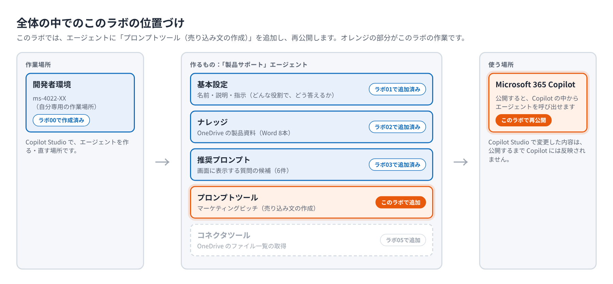

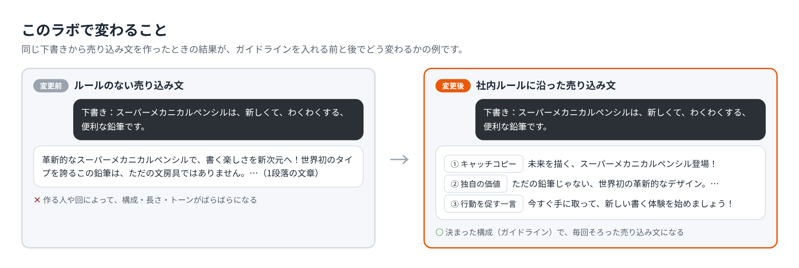

このラボでは以下のタスクを実施します。

　**タスク１：プロンプトツールを作成する**

　**タスク２：プロンプトをテストして改善する**

　**タスク３：エージェントの指示と推奨プロンプトを更新する**

　**タスク４：Copilot Studio でテストする**

　**タスク５：エージェントを再公開して Microsoft 365 Copilot でテストする**


## 予想時間: 30分


## タスク1 - プロンプトツールを作成する

> **このタスクの目的：** 売り込み文を作るための指示（プロンプト）を作成します。「下書き」の部分に、利用者が入力した文章が入ります。

1. Copilot Studio の「**製品サポート**」の画面で、「**ツール**」の欄にある「**＋ ツールを追加する**」をクリックします。

   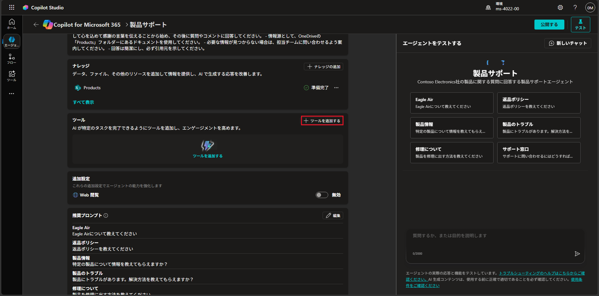

   

2. 「**ツールを追加する**」の画面で、「**新規作成**」の「**プロンプト**」をクリックします。

   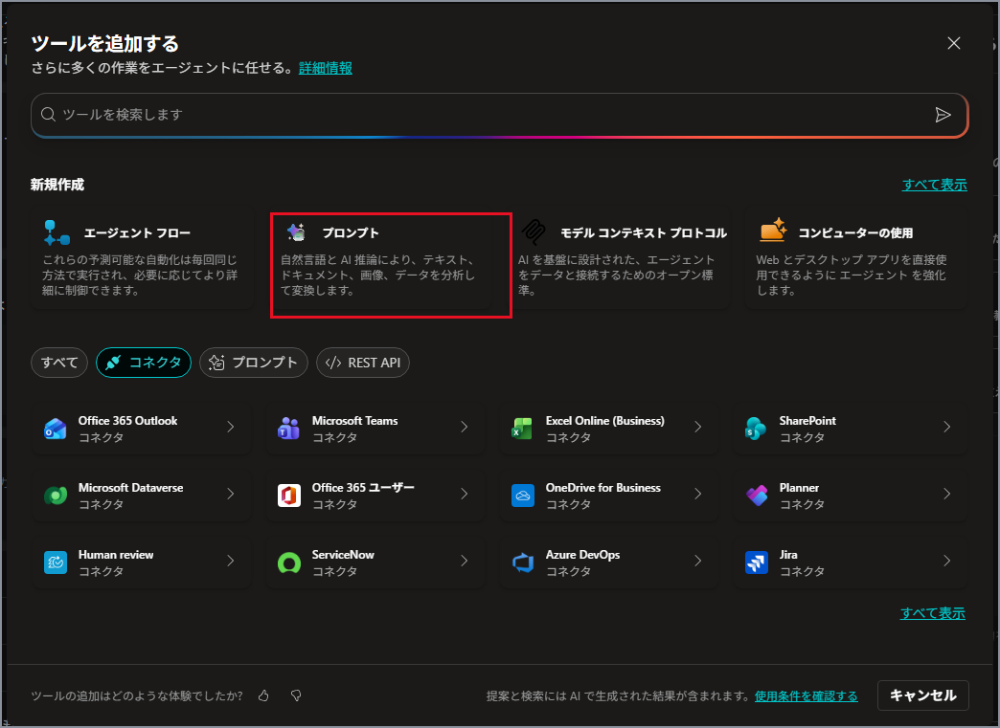

   

3. プロンプトの編集画面が表示されます。画面左上の「**Custom prompt 〜**」と表示されている名前をクリックします。

   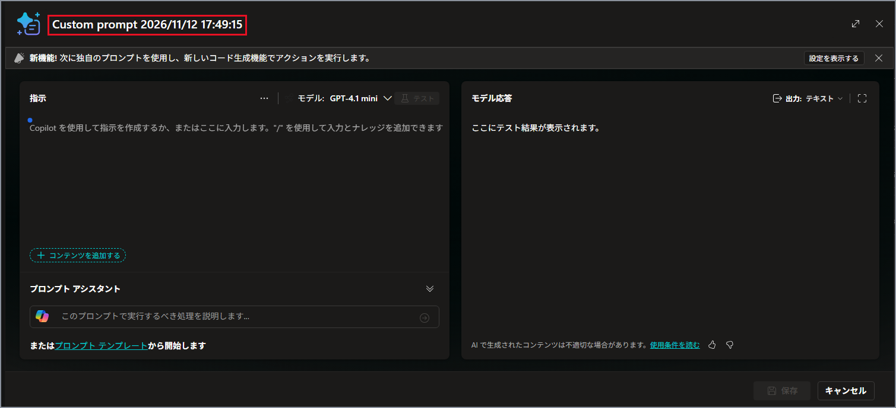

   

4. 名前の文字をすべて消して、以下の名前を入力します。

   ```
   マーケティングピッチ
   ```

   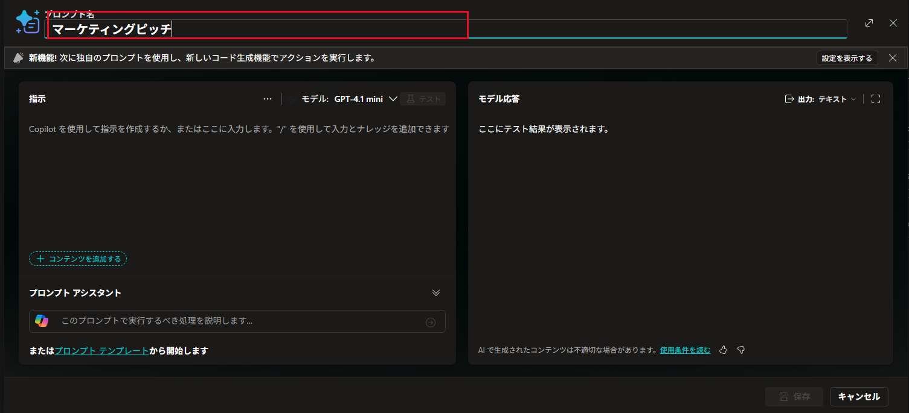

   

5. 「**指示**」の入力欄をクリックし、以下の文章を貼り付けます。

   ```
   次の下書きをもとに、製品のマーケティングピッチ（売り込み文）を作成してください：
   ```

   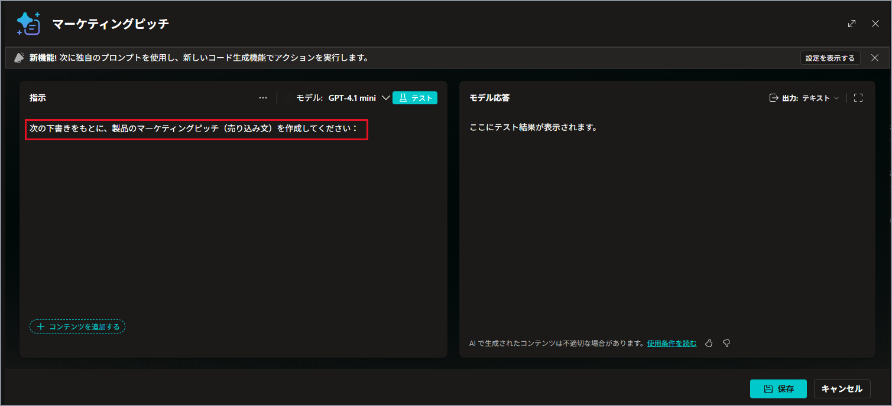

   

6. 貼り付けた文章の最後（「：」の後ろ）にカーソルがある状態で、半角の「**/**」を入力します。表示されたメニューの「**入力**」にある「**テキスト**」をクリックします。

   > 注：指示欄の左下の「**＋ コンテンツを追加する**」をクリックしても、同じメニューが表示されます。

   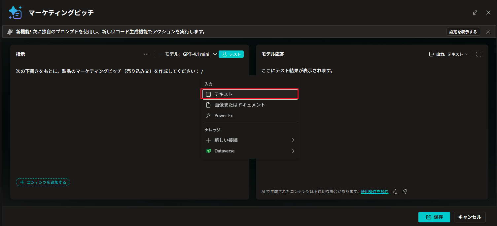

   

7. 「**テキスト入力**」の小さな画面が表示されます。

   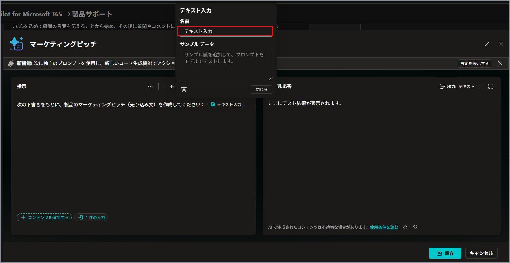

   

8. 以下の項目を入力し、「**閉じる**」をクリックします。

   > 注：「下書き」は、利用者が入力する文章が入る場所（入れ物）です。「サンプル データ」は、テスト用に仮で入れておく文章です。

   | 項目           | 値                                                           |
   | -------------- | ------------------------------------------------------------ |
   | 名前           | 「テキスト入力」を消して `下書き` を入力                     |
   | サンプル データ | `スーパーメカニカルペンシルは、新しくて、わくわくする、便利な鉛筆です。世界初のタイプの鉛筆というだけでなく、使っていて楽しい鉛筆です。` |

   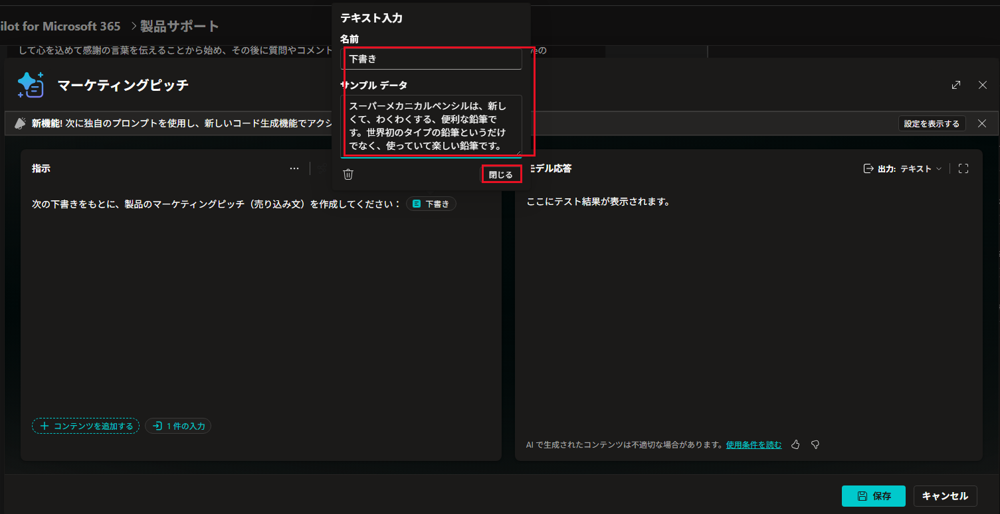

   

9. 指示の文章の最後に「**下書き**」が追加されたことを確認します。

   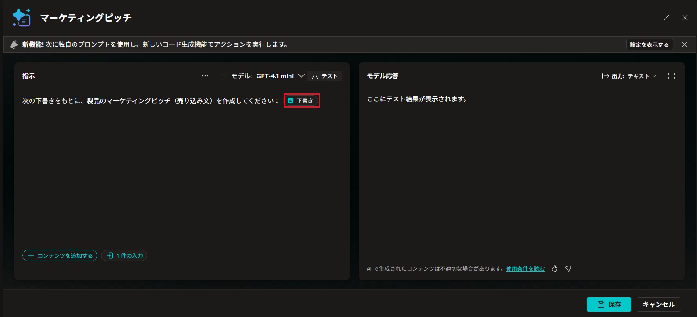

   


## タスク2 - プロンプトをテストして改善する

> **このタスクの目的：** プロンプトを試し、ガイドライン（構成のルール）を追加して結果がどう変わるかを確認します。作成したツールをエージェントに追加します。

1. 指示欄の右上にある「**テスト**」をクリックします。画面右側の「**モデル応答**」に、サンプル データをもとにした売り込み文が表示されることを確認します。

   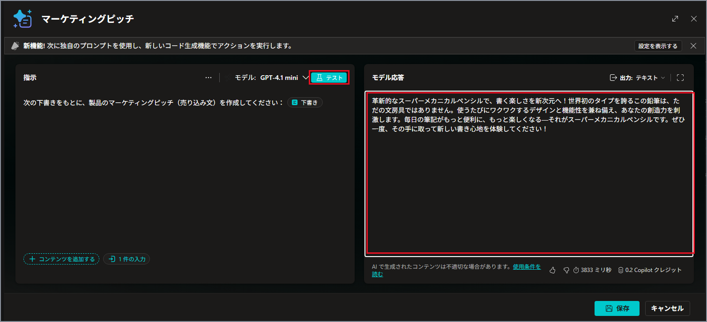

   

2. 次に、売り込み文のルール（ガイドライン）を追加します。指示欄の「**下書き**」の後ろをクリックし、**Enter** キーを押して改行してから、以下の文章を貼り付けます。

   ```
   ピッチは、次のContoso社のガイドラインに従ってください：
   - 短いキャッチコピーから始める
   - 独自の価値（他にはない魅力）を説明する
   - 最後に行動を促す一言で締めくくる
   - わくわくする、心を動かす口調にする
   ```

   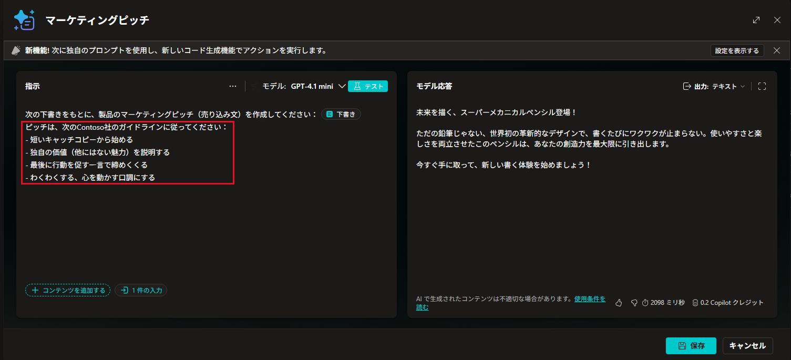

   

3. もう一度「**テスト**」をクリックします。「**モデル応答**」が「キャッチコピー → 独自の価値 → 行動を促す一言」の構成に変わったことを確認し、画面右下の「**保存**」をクリックします。

   > 注：応答の内容は毎回異なります。構成が変わっていれば問題ありません。

   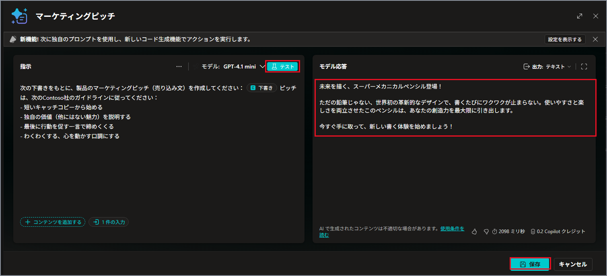

   

4. 「**ツールを追加する**」の画面が表示されたら、「**追加と構成**」をクリックします。

   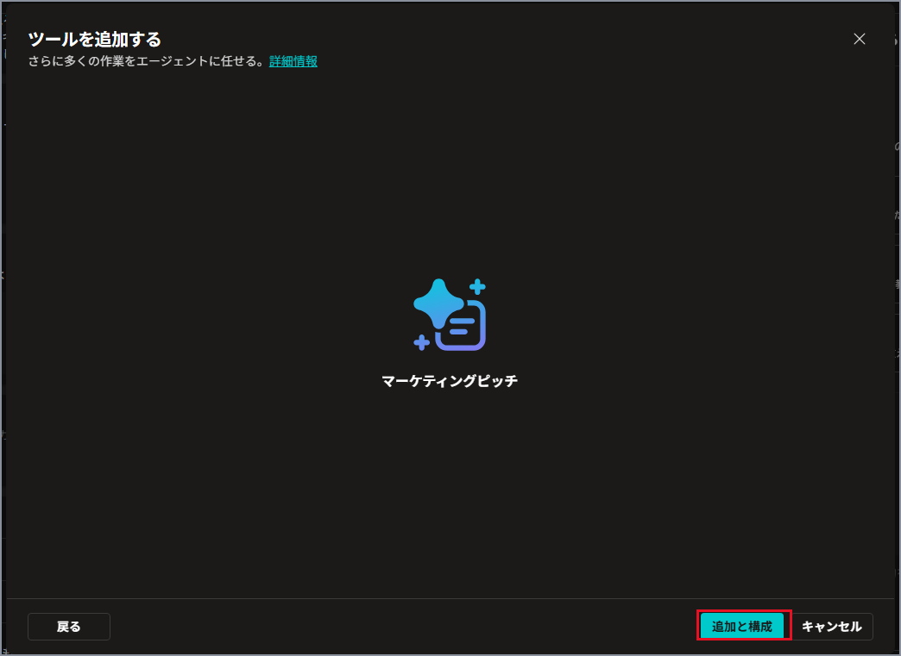

   

5. 「**製品サポート**」の画面に戻り、「**ツール**」の欄に「**マーケティングピッチ- prompt**」が表示されたことを確認します。

   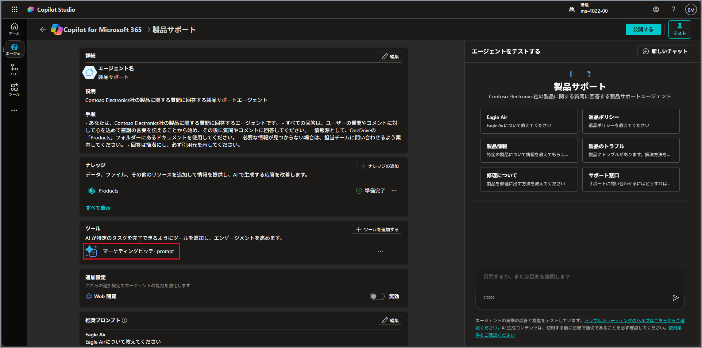

   


## タスク3 - エージェントの指示と推奨プロンプトを更新する

> **このタスクの目的：** エージェントがツールを使う場面を指示に追加し、ツール用の質問の候補を登録します。

1. 「**詳細**」の欄の右上にある「**編集**」をクリックします。

   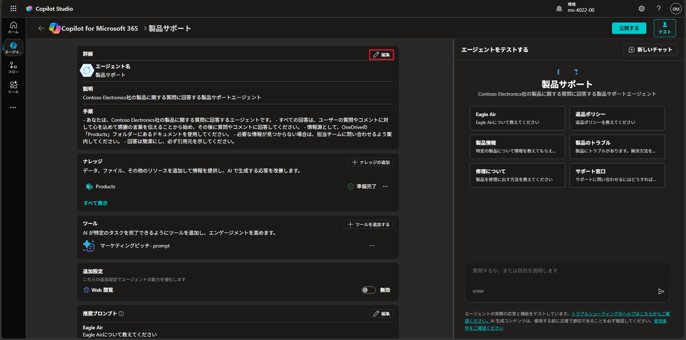

   

2. 「**手順**」の入力欄の文章の最後で **Enter** キーを押して改行し、以下の文章を1行追加します。追加したら「**保存**」をクリックします。

   ```
   - ユーザーの下書きをもとに製品のピッチを作成する場合は、「マーケティングピッチ」ツールを使用して、Contoso社のガイドラインに沿ったピッチを作成してください。
   ```

   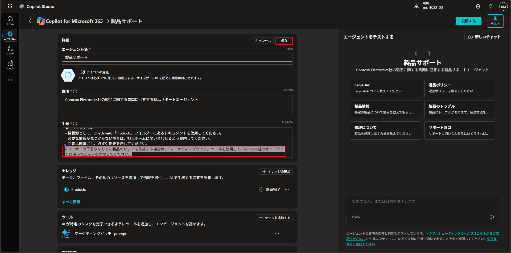

   

3. 画面を下にスクロールし、「**推奨プロンプト**」の欄の右上にある「**編集**」をクリックします。

   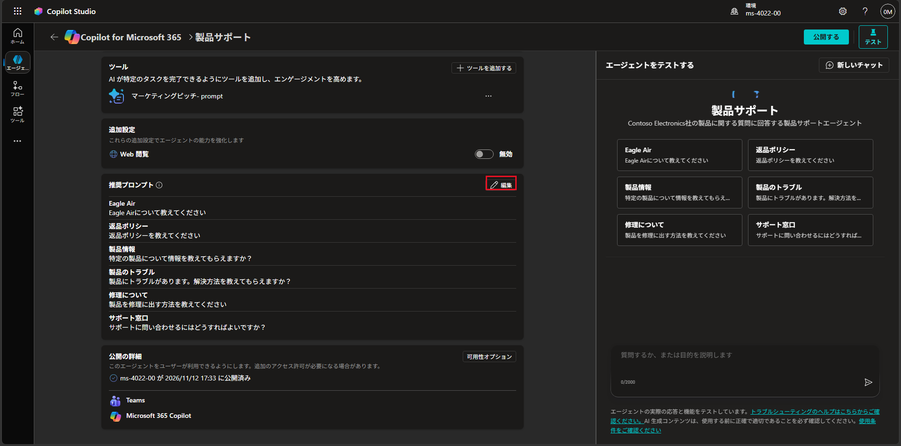

   

4. 1行目の「**Eagle Air**」を以下の内容に書き換え、「**保存**」をクリックします。

   | タイトル               | プロンプト                                                   |
   | ---------------------- | ------------------------------------------------------------ |
   | `マーケティングピッチ` | `次の下書きをもとに、Contoso社のガイドラインに沿ったマーケティングピッチを作成してください：` |

   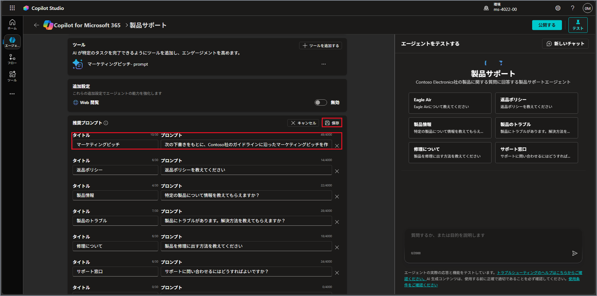

   


## タスク4 - Copilot Studio でテストする

> **このタスクの目的：** エージェントに下書きを渡して、ガイドラインに沿った売り込み文が作られるかを確認します。

1. 画面右側の「**エージェントをテストする**」で「**マーケティングピッチ**」をクリックします。入力欄にプロンプトの文章が入ったことを確認します。

   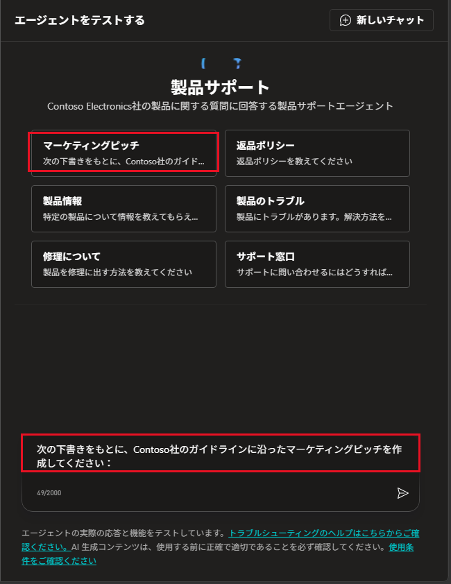

   

2. 入力欄の文章の最後（「：」の後ろ）をクリックし、続けて以下の下書きを入力して、送信ボタンをクリックします。

   ```
   Eagle Airは、農家の方の作物の見回りに使えるドローンです。長く飛べて、広い畑でも1回で見回れます。
   ```

   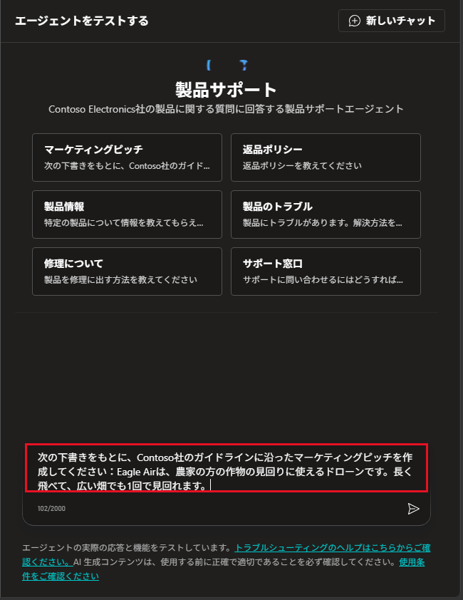

   

3. Eagle Air の資料に基づいた売り込み文（ピッチ案）が作成されたことを確認します。

   > 注：回答の内容は毎回異なります。

   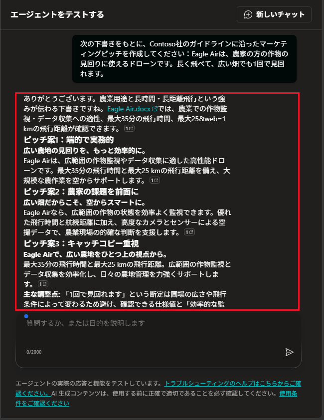

   


## タスク5 - エージェントを再公開して Microsoft 365 Copilot でテストする

> **このタスクの目的：** 変更内容を公開し、Copilot でも同じように使えるかを確認します。

1. 画面右上の「**公開する**」をクリックします。

   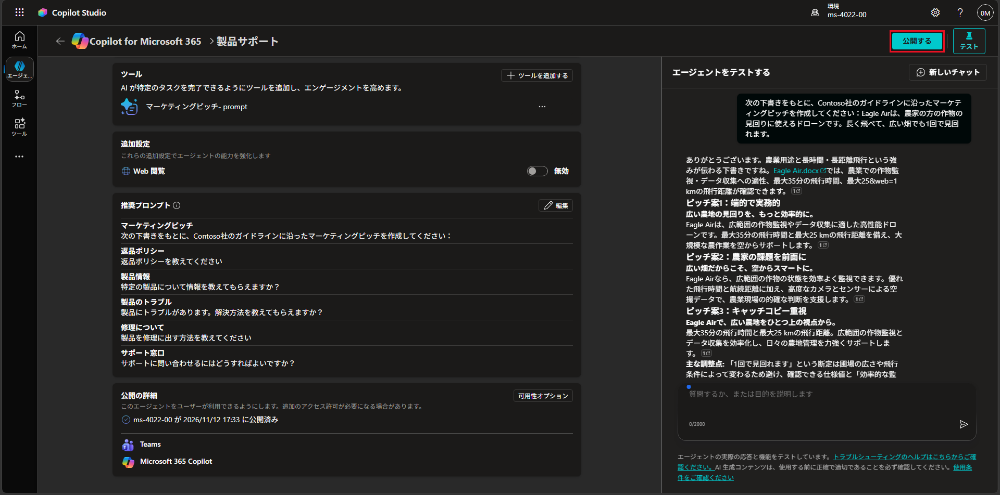

   

2. 「**エージェントを公開する**」の画面で「**公開**」をクリックします。

   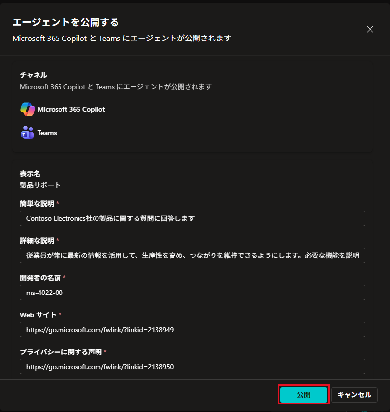

   

3. 「**可用性オプション**」の画面が表示されたら、「**完了**」をクリックします。

   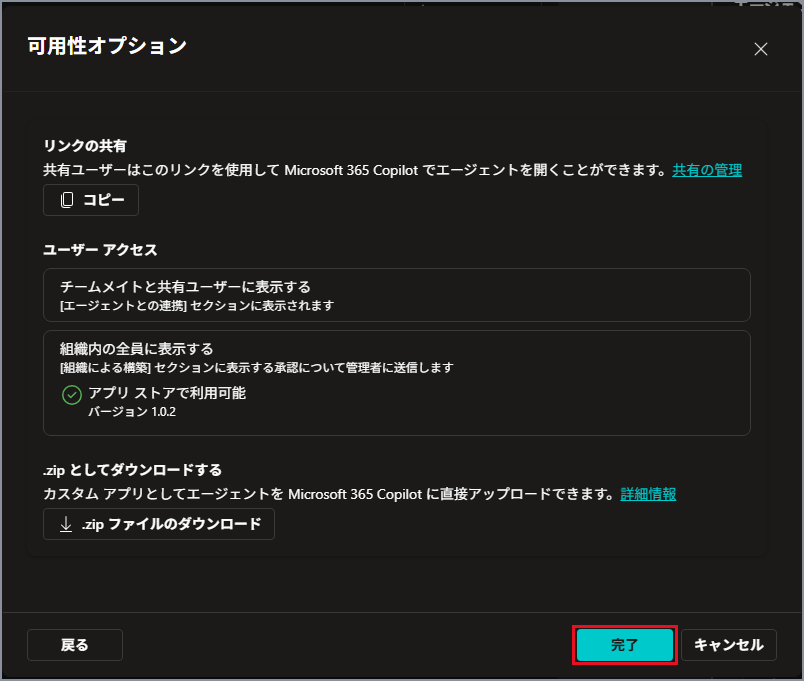

   

4. **5〜10分ほど待ってから**、Microsoft 365 Copilot のタブに切り替えます。画面左の「**新しいチャット**」をクリックし、「**エージェント**」にマウスポインターを合わせて「**製品サポート**」をクリックします。

   > 注：Copilot のタブを閉じた場合は、ラボ03のタスク4の手順1の URL を開いてください。

   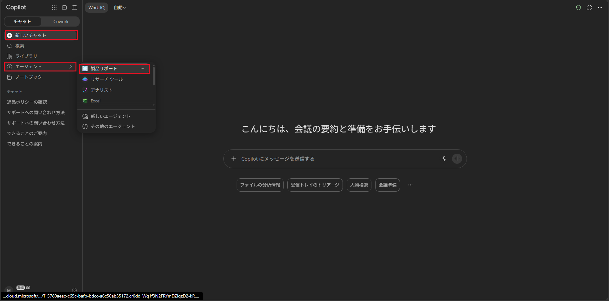

   

5. 推奨プロンプトに「**マーケティングピッチ**」が表示されていることを確認し、クリックします。

   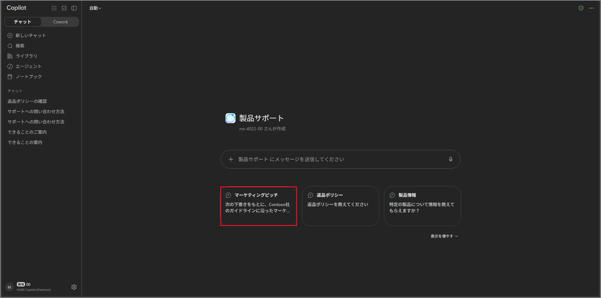

   

6. 入力欄の文章の最後に、タスク4の手順2と同じ下書きを続けて入力し、送信します。

   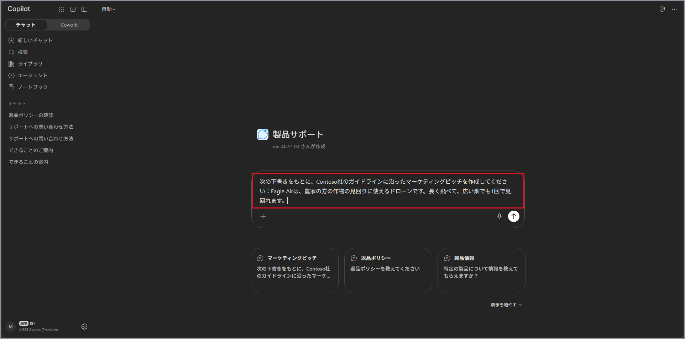

   

7. 「**製品サポート に接続します**」と表示された場合は、「**許可**」をクリックします。

   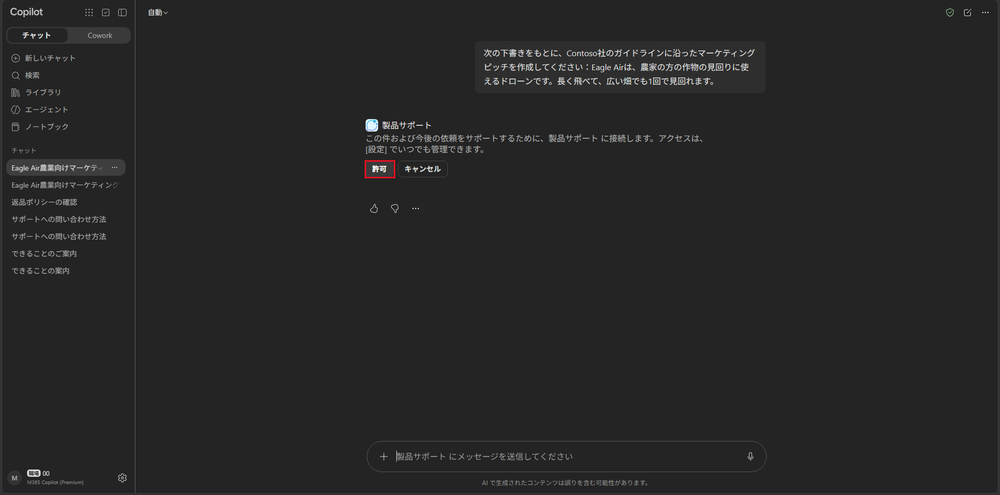

   

8. 感謝の言葉で始まり、ピッチ案が作成されたことを確認します。

   > 注：回答が「**Copilotエージェントをご利用いただきありがとうございます！**」で始まり、ピッチ案が作成されない場合は、古い設定のままです。数分待ってから「**新しいチャット**」で製品サポートを開き直し、手順5からやり直してください。

   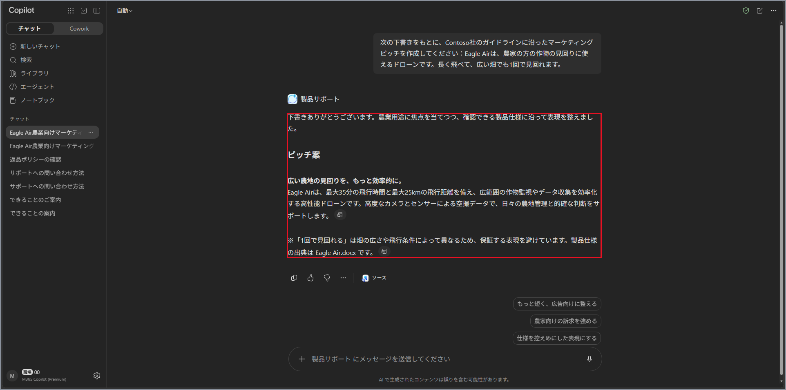

   

以上で本ラボは完了です。
