# ラボ05：コネクタツールを作成してエージェントに追加

## ラボ シナリオ

問い合わせの中には「どんな資料がありますか？」という質問もあります。ラボ02で追加したナレッジは資料の「中身」を読んで答える仕組みのため、資料の一覧を漏れなく答えるのは苦手です。

「コネクタツール」とは、OneDrive や Outlook などの他のサービスにつないで、データの取得や操作を行うツールです。このラボでは、OneDrive の「Products」フォルダーにあるファイルの一覧を取得する「製品サポートファイルの一覧」ツールを作成し、エージェントに追加します。

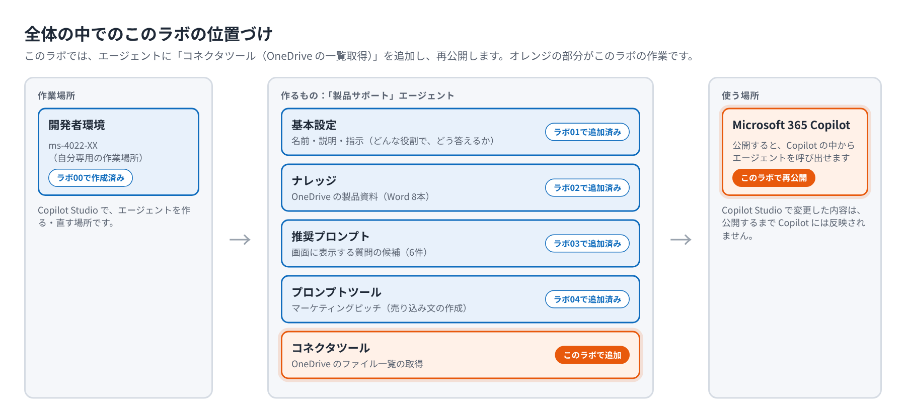

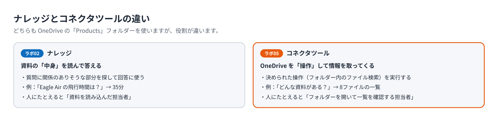

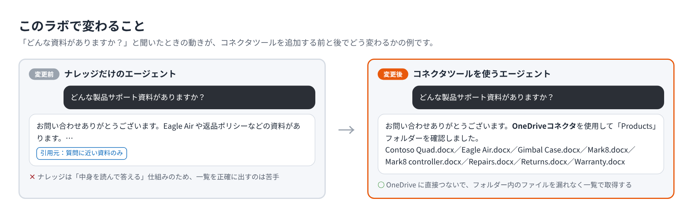

このラボでは以下のタスクを実施します。

　**タスク１：コネクタツールを追加する**

　**タスク２：コネクタツールを設定する**

　**タスク３：エージェントの指示を更新する**

　**タスク４：Copilot Studio でテストする**

　**タスク５：エージェントを再公開して Microsoft 365 Copilot でテストする**


## 予想時間: 30分


## タスク1 - コネクタツールを追加する

> **このタスクの目的：** OneDrive に接続するツールを選び、自分のアカウントで接続します。

1. Copilot Studio の「**製品サポート**」の画面で、「**ツール**」の欄にある「**＋ ツールを追加する**」をクリックします。

   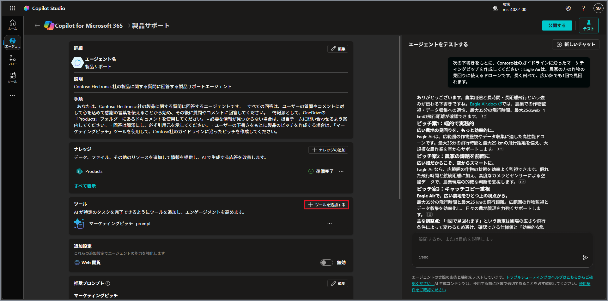

   

2. 「**ツールを追加する**」の画面で「**コネクタ**」をクリックし、一覧から「**OneDrive for Business**」をクリックします。

   > 注：一覧に表示されない場合は、画面上部の検索欄に `OneDrive` と入力して検索してください。

   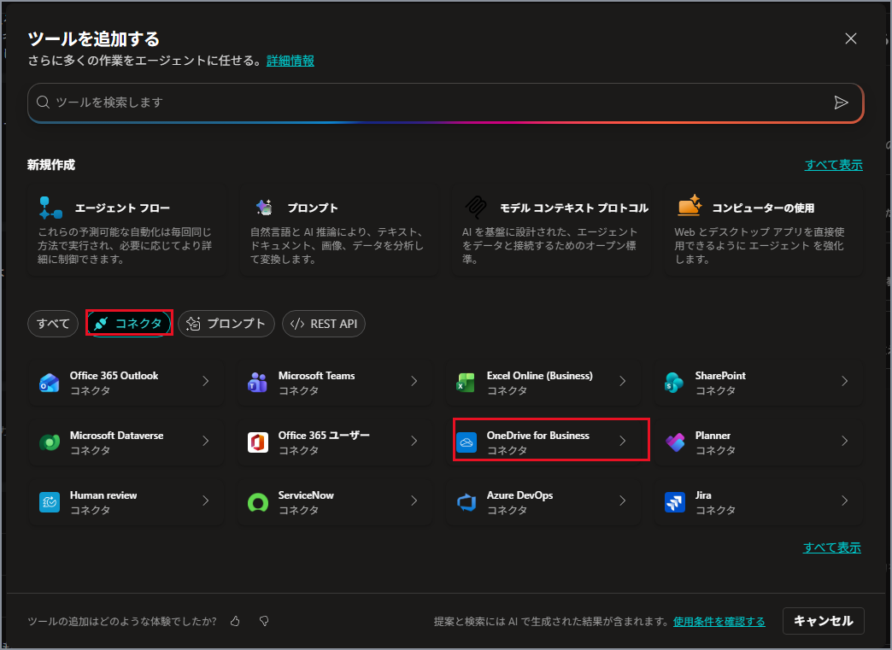

   

3. OneDrive for Business の操作の一覧から「**パスによるフォルダー内のファイルの検索**」をクリックします。

   > 注：名前が途中までしか表示されない場合は、マウスポインターを合わせると全体が表示されます。

   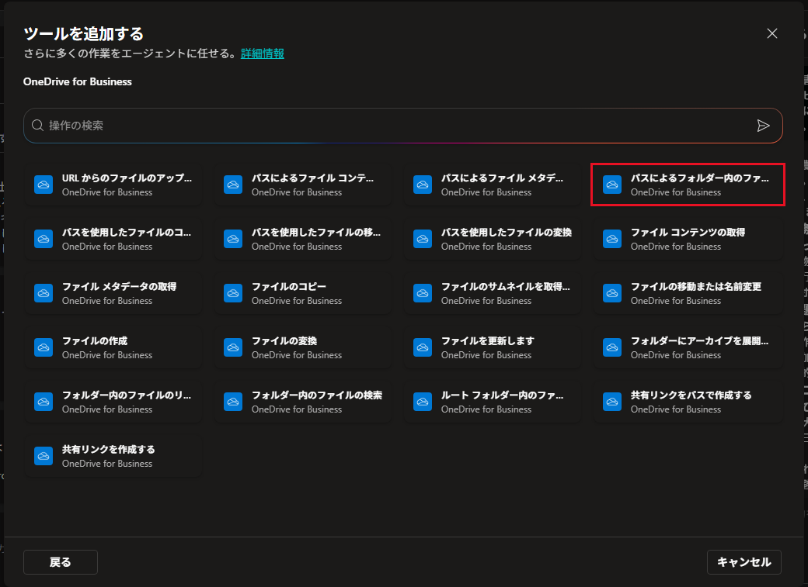

   

4. 「**Find files in folder by path**」の画面が表示されます。「**接続**」が「**未接続**」になっているので、右側の「**∨**」をクリックします。

   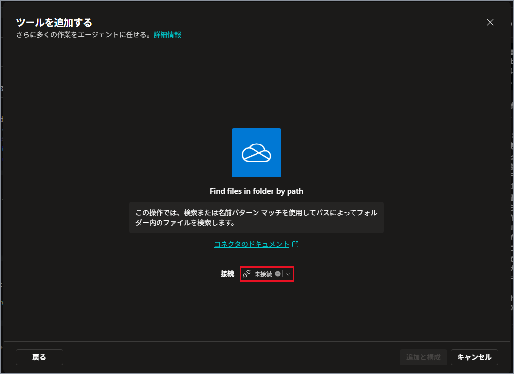

   

5. 「**新しい接続を作成する**」をクリックします。

   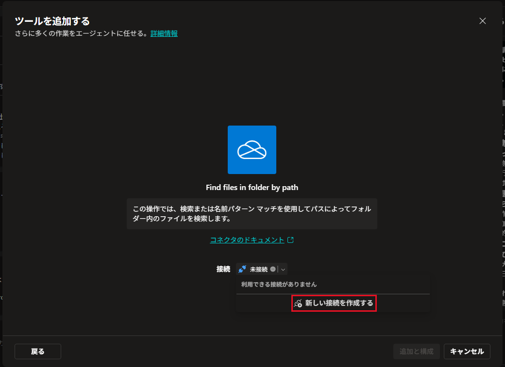

   

6. 「**OneDrive for Business に接続する**」の画面で、「**表示名**」は空欄のまま「**作成**」をクリックします。

   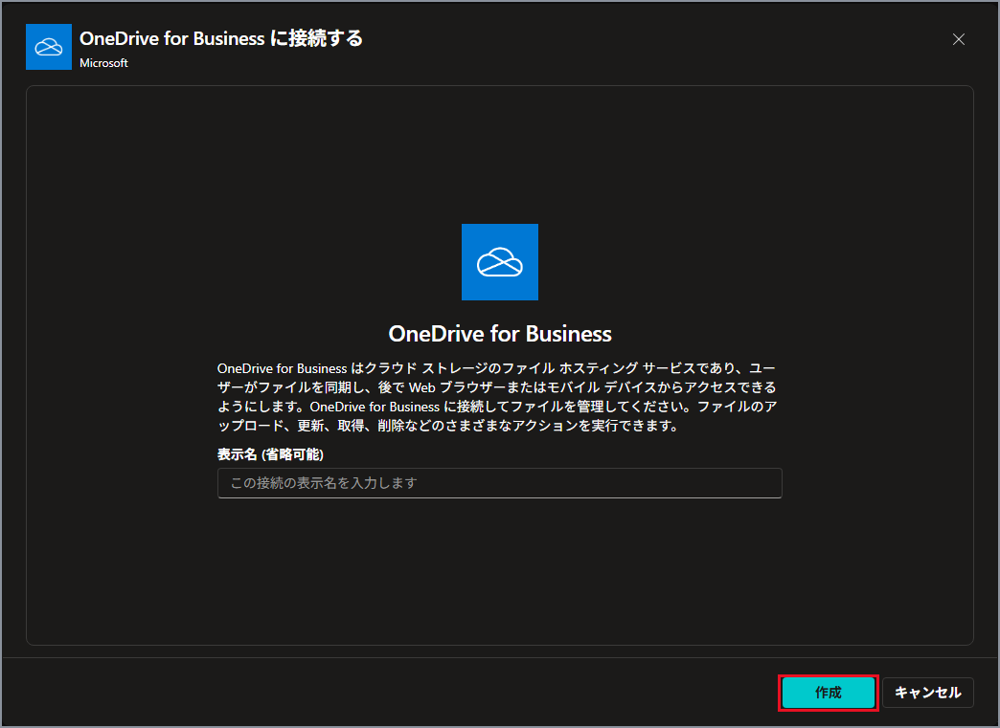

   

7. 「**アカウントを選択する**」の画面が表示されたら、講師から事前に配布したアカウント（`ms-4022-XX`）をクリックします。

   > 注：XXはご自身のアカウント番号です。

   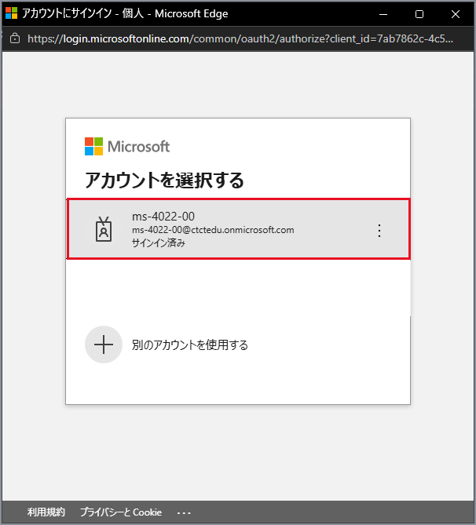

   

8. 「**接続**」がご自身のアカウントになり、緑のチェックが表示されたことを確認して、「**追加と構成**」をクリックします。

   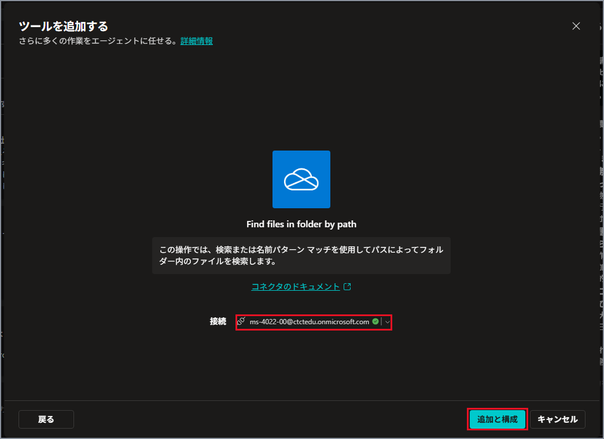

   

9. 「**ツール**」の欄に「**パスによるフォルダー内のファイルの検索- connector**」が追加されたことを確認し、クリックします。

   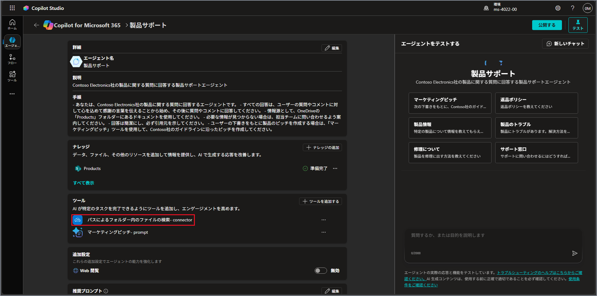

   


## タスク2 - コネクタツールを設定する

> **このタスクの目的：** ツールが「どのフォルダーの、どのファイルを探すか」を固定値で設定します。

1. ツールの設定画面が表示されます。「**詳細**」の以下の項目の文字をすべて消してから入力します。

   | 項目 | 値                                                           |
   | ---- | ------------------------------------------------------------ |
   | 名前 | `製品サポートファイルの一覧`                                 |
   | 説明 | `OneDriveの「Products」フォルダーにある製品サポートファイルの一覧を取得します` |

   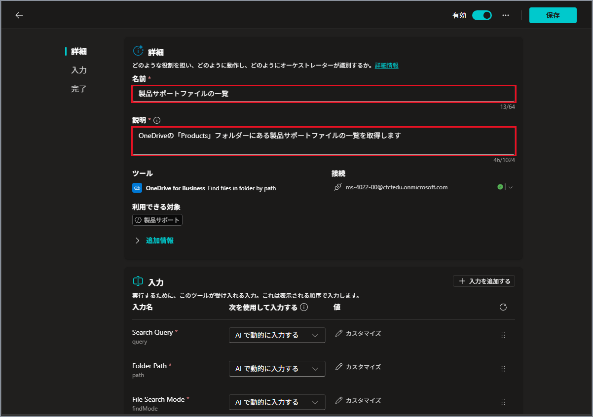

   

2. 画面を下にスクロールし、「**入力**」の欄を表示します。「**Search Query**」の「**AI で動的に入力する**」をクリックし、「**カスタム値**」をクリックします。

   > 注：「AI で動的に入力する」のままだと、質問のたびに AI が値を推測するため、毎回同じ結果になりません。値を固定するために「カスタム値」を選びます。

   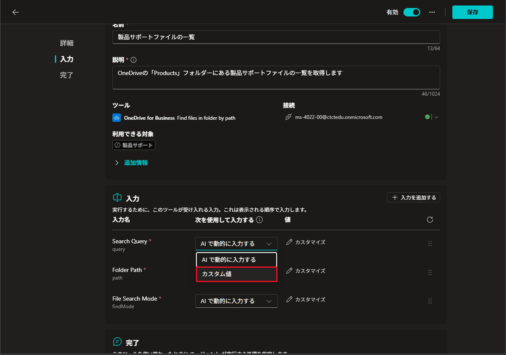

   

3. 「**Search Query**」の値の欄に、以下を半角で入力します。

   ```
   .*
   ```

   > 注：「.*」（ドットとアスタリスク）は「すべてのファイル」を表す記号です。

   

   

4. 同様に、「**Folder Path**」の「**AI で動的に入力する**」をクリックし、「**カスタム値**」をクリックします。

   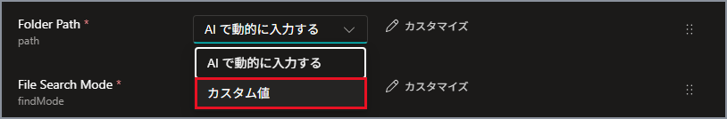

   

5. 「**Folder Path**」の値の欄に、以下を半角で入力します。

   ```
   /Products
   ```

   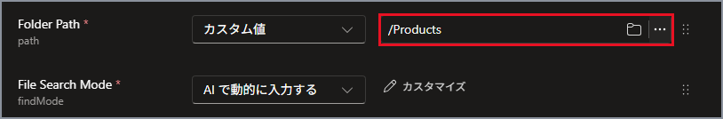

   

6. 同様に、「**File Search Mode**」の「**AI で動的に入力する**」をクリックし、「**カスタム値**」をクリックします。

   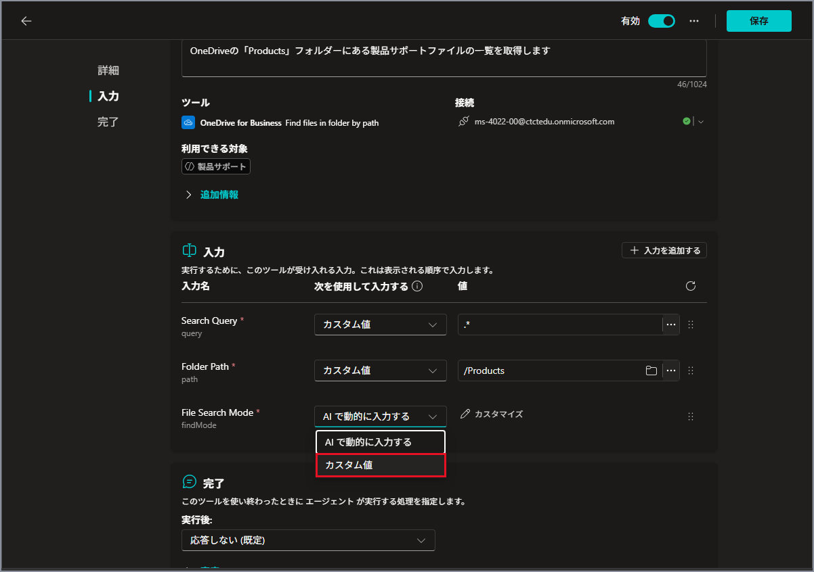

   

7. 「**File Search Mode**」の値の欄をクリックし、表示された一覧から「**Pattern**」をクリックします。

   > 注：「Pattern」を選ぶと、Search Query の「.*」が記号として扱われ、すべてのファイルが取得されます。

   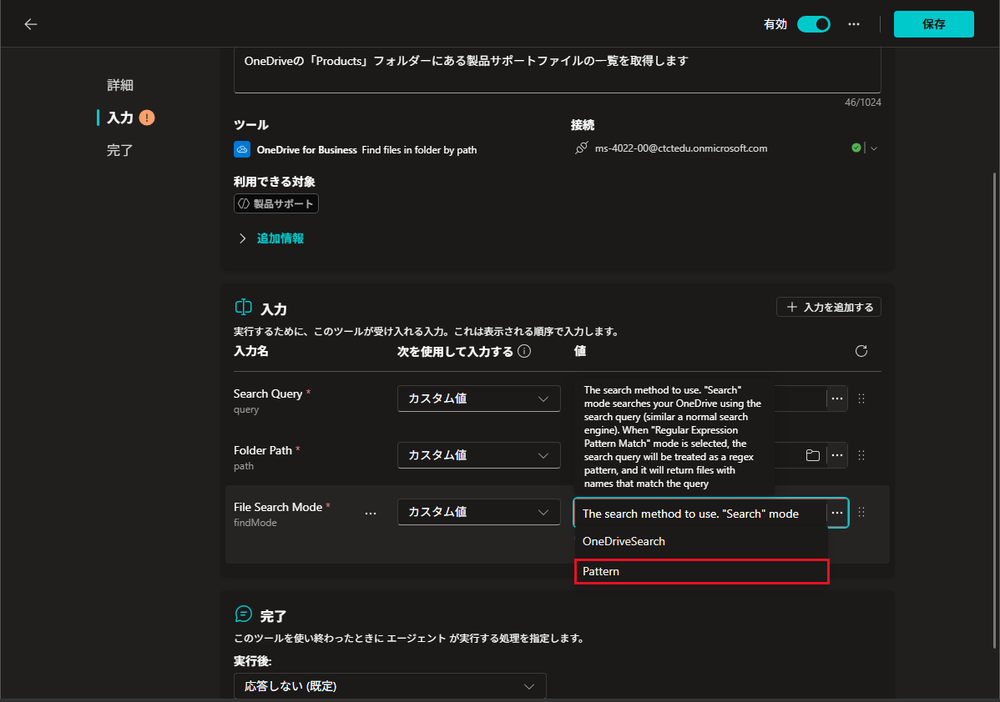

   

8. 3つの入力が以下のとおりになっていることを確認し、画面右上の「**保存**」をクリックします。

   | 入力名           | 次を使用して入力する | 値          |
   | ---------------- | -------------------- | ----------- |
   | Search Query     | カスタム値           | `.*`        |
   | Folder Path      | カスタム値           | `/Products` |
   | File Search Mode | カスタム値           | `Pattern`   |

   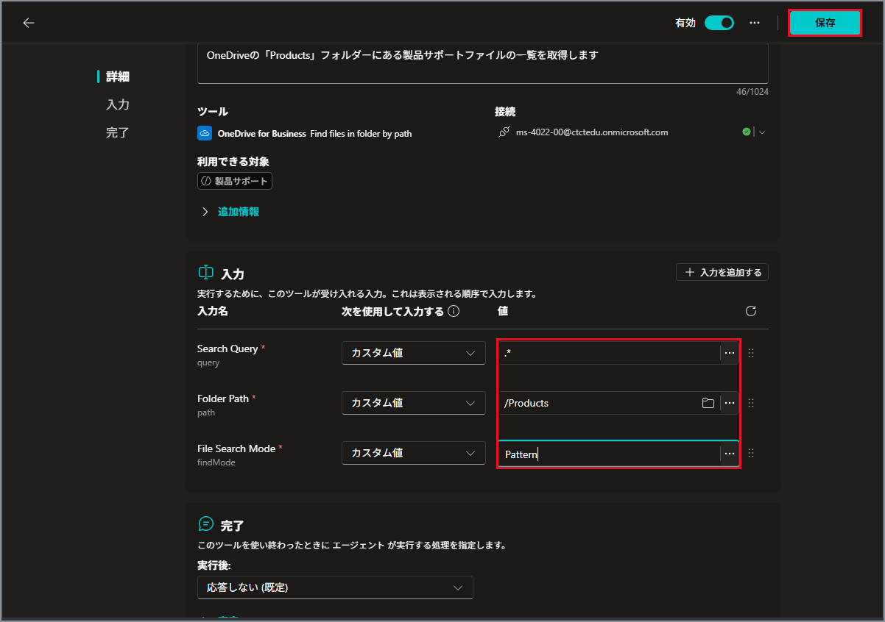

   

9. 保存が完了したら、画面左上の「**←**」をクリックして「**製品サポート**」の画面に戻ります。

   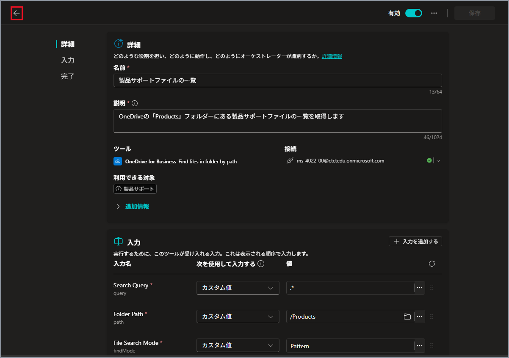

   


## タスク3 - エージェントの指示を更新する

> **このタスクの目的：** エージェントがツールを使う場面を指示に追加します。

1. 「**ツール**」の欄に「**製品サポートファイルの一覧- connector**」が表示されていることを確認し、「**詳細**」の欄の右上にある「**編集**」をクリックします。

   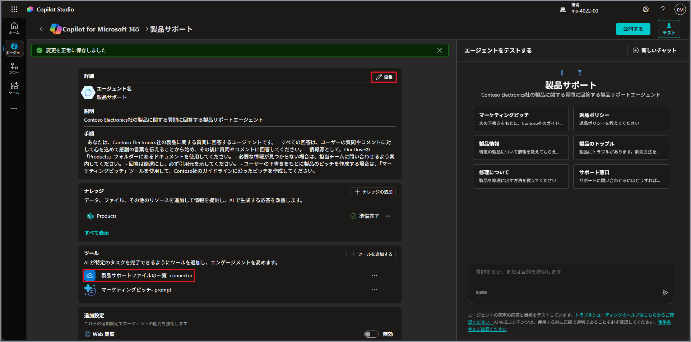

   

2. 「**手順**」の入力欄の文章の最後で **Enter** キーを押して改行し、以下の文章を1行追加します。追加したら「**保存**」をクリックします。

   ```
   - 利用できるサポート資料について質問された場合は、「製品サポートファイルの一覧」ツールを使用してOneDriveの「Products」フォルダーにあるファイルの一覧を取得し、OneDriveコネクタを使用したことをユーザーに伝えてください。
   ```

   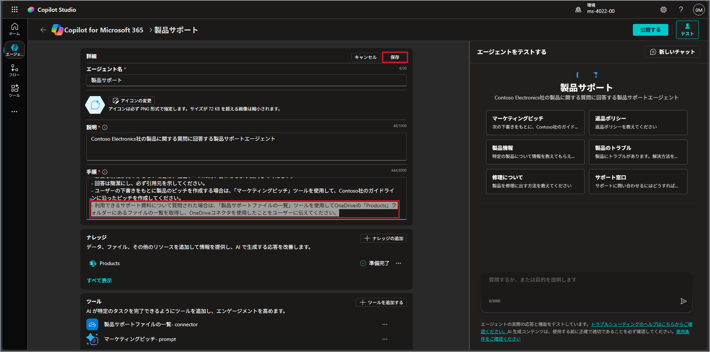

   


## タスク4 - Copilot Studio でテストする

> **このタスクの目的：** 「どんな資料があるか」を質問し、ツールで OneDrive から一覧を取得できるかを確認します。

> 注：ツールを追加すると、「エージェントをテストする」の表示が変わる場合がありますが、問題ありません。

1. 画面右側の「**エージェントをテストする**」の「**新しいチャット**」をクリックします。入力欄に以下の文章を入力し、送信ボタンをクリックします。

   ```
   利用できる製品サポートファイルを教えてください
   ```

   回答に「**OneDriveコネクタを使用して**」と表示され、8つのファイルが一覧で表示されることを確認します。

   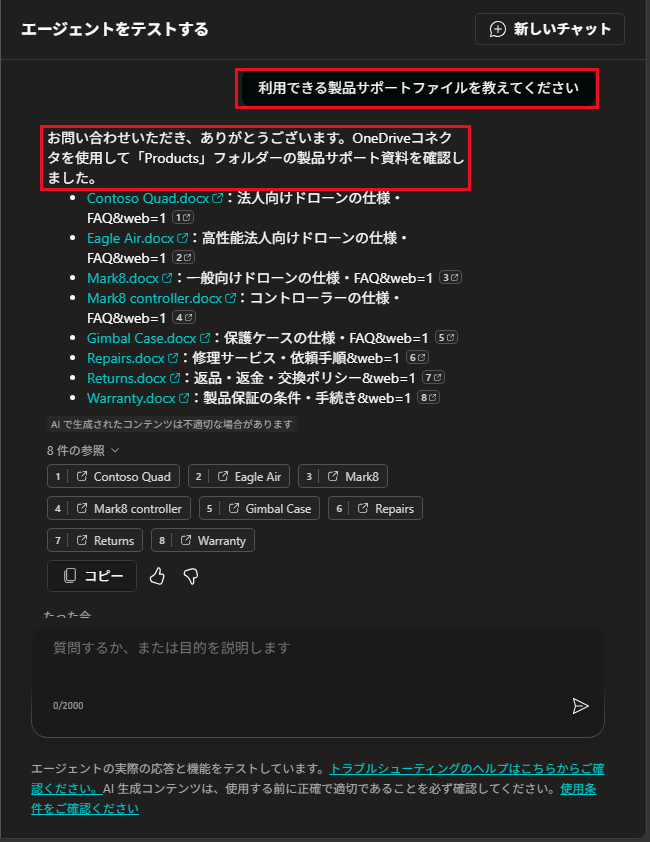

   

2. 次に、ツールを指定して質問します。以下の文章を入力して送信します。

   ```
   製品サポートファイルの一覧ツールを使って、Productsフォルダーのファイル名を一覧にしてください
   ```

   回答の下の参照に、「**Contoso Quad.docx**」のような**拡張子（.docx）付きのファイル名**と「**Products**」が表示されていることを確認します。これらが、作成したコネクタツールで OneDrive から取得した結果です。

   > 注：「続行するには接続してください」等が表示された場合は、「**許可**」をクリックしてください。

   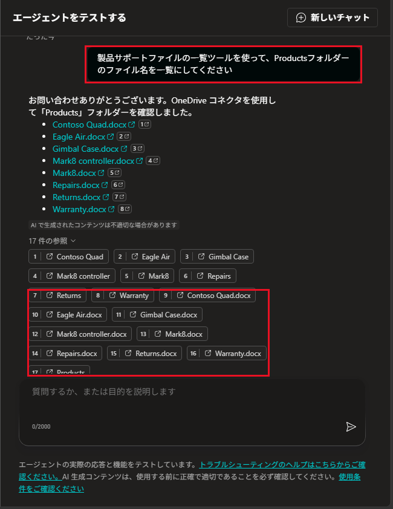

   


## タスク5 - エージェントを再公開して Microsoft 365 Copilot でテストする

> **このタスクの目的：** 変更内容を公開し、Copilot でも同じように使えるかを確認します。

1. 画面右上の「**公開する**」をクリックします。

   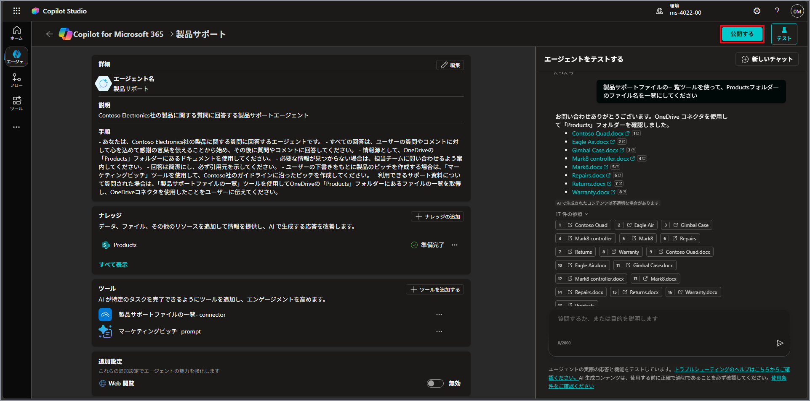

   

2. 「**エージェントを公開する**」の画面で「**公開**」をクリックします。

   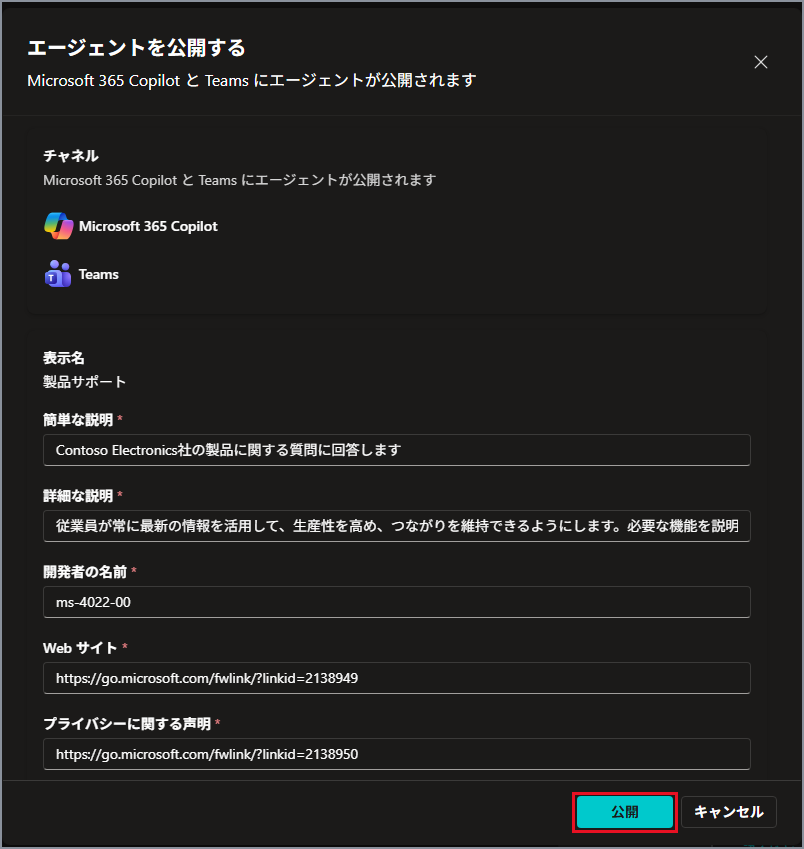

   

3. 「**可用性オプション**」の画面が表示されたら、「**完了**」をクリックします。

   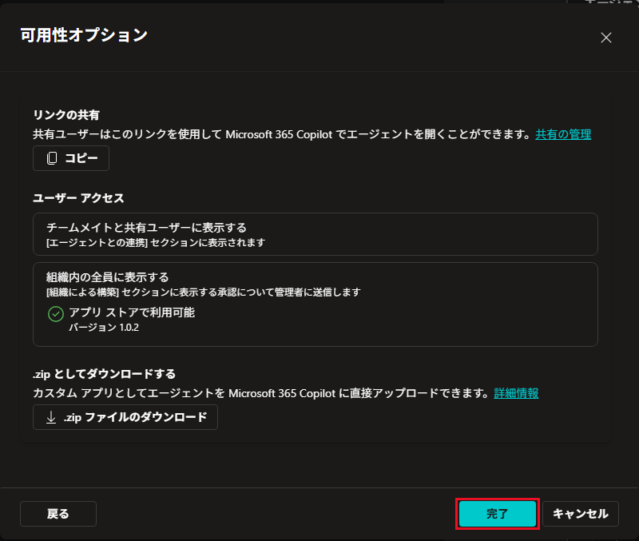

   

4. **5〜10分ほど待ってから**、Microsoft 365 Copilot のタブで「**新しいチャット**」をクリックし、「**エージェント**」から「**製品サポート**」を開きます（ラボ04 タスク5の手順4と同じ操作です）。入力欄に以下の文章を入力して送信します。

   ```
   製品サポートファイルの一覧ツールを使って、Productsフォルダーのファイル名を一覧にしてください
   ```

   > 注：回答まで1分ほどかかる場合があります。途中で英語の表示（Planning additional searches など）が出ても、そのまま待ちます。
   >
   > 注：「製品サポート に接続します」と表示された場合は、「**許可**」をクリックしてください。

   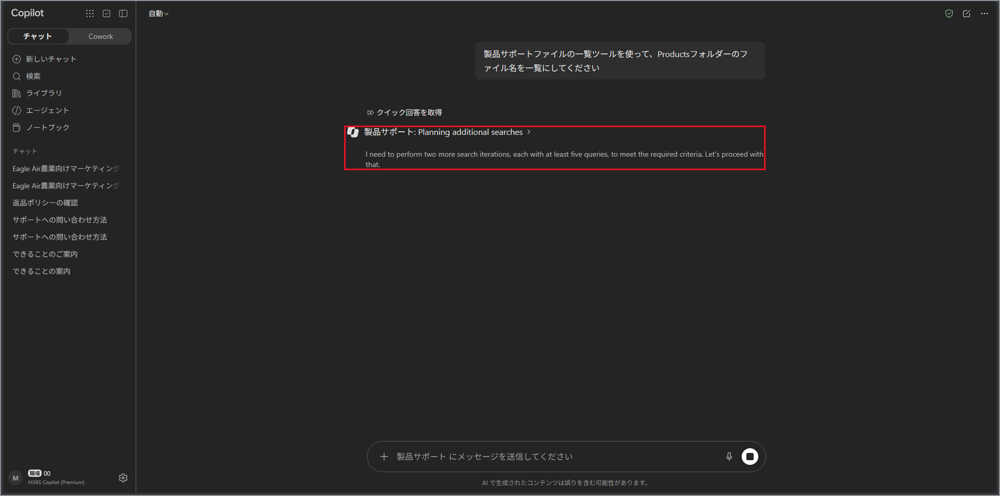

   

5. 「**OneDriveコネクタ**」を使って「Products」フォルダーを確認した旨と、8つのファイルの一覧が表示されていることを確認します。

   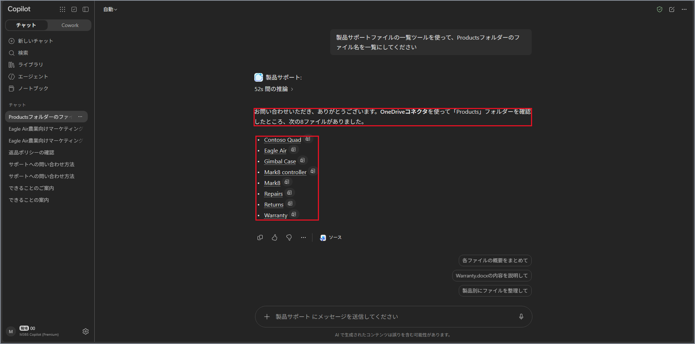

   

以上で本ラボは完了です。
